# 1.基础使用

## 目录

- [1）登录](#1登录)
  - [内网LDAP登录](#内网LDAP登录)
  - [附带JWT认证](#附带JWT认证)
  - [验证码](#验证码)
  - [登录其他内容](#登录其他内容)
- [2）顶部功能栏](#2顶部功能栏)
- [3）tab标签栏](#3tab标签栏)
- [4）工作台（设计阶段）](#4工作台设计阶段)
  - [统计栏](#统计栏)
  - [公告栏（暂未完工）](#公告栏暂未完工)
  - [其他信息](#其他信息)
- [5）用户中心](#5用户中心)
  - [个人资料和安全设置](#个人资料和安全设置)
  - [操作日志和登录日志](#操作日志和登录日志)
- [6）用户管理](#6用户管理)
  - [权限问题](#权限问题)
  - [新增平台用户](#新增平台用户)
  - [编辑用户](#编辑用户)
  - [删除用户](#删除用户)
- [7）字典管理（设计阶段）](#7字典管理设计阶段)
  - [描述](#描述)
  - [字段数据管理](#字段数据管理)
  - [如何决定后续选项](#如何决定后续选项)
  - [字典的设计缺陷](#字典的设计缺陷)
- [8）项目联系信息](#8项目联系信息)
  - [录入字段](#录入字段)
  - [关联数据](#关联数据)
- [9）缩略语](#9缩略语)
- [10）日志](#10日志)
  - [登录日志](#登录日志)
  - [数据操作日志](#数据操作日志)
  - [接口操作日志](#接口操作日志)
- [11）项目管理](#11项目管理)
  - [文档模版和片段](#文档模版和片段)
  - [预览功能](#预览功能)
  - [项目看板](#项目看板)
  - [新增项目](#新增项目)
    - [字段详细](#字段详细)
- [附录](#附录)
  - [附录1时间关联说明（暂定）](#附录1时间关联说明暂定)
    - [相关时间](#相关时间)
    - [大纲](#大纲)
    - [说明](#说明)
    - [记录](#记录)
    - [回归说明](#回归说明)
    - [回归记录](#回归记录)
    - [报告](#报告)

## 1）登录

本部分内容介绍如何登录该系统，讲解登录页面的操作，包括内网登录、JWT逻辑、验证码、登录逻辑等内容

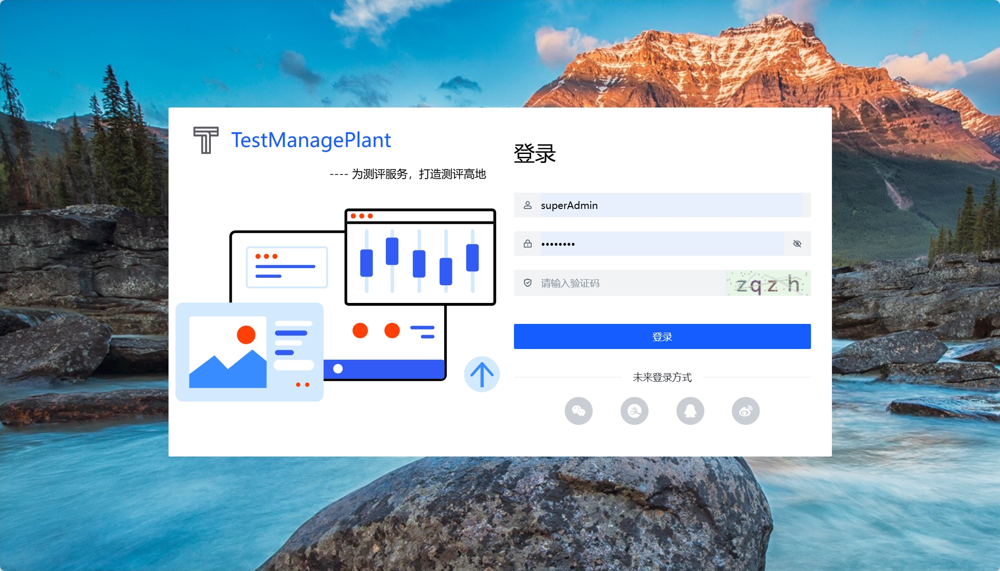

### 内网LDAP登录

- 系统支持内网LDAP账户直接登录，认证是在LDAP服务器进行验证，本平台在每次用户登录时，从LDAP服务器更新账户信息，所有账户认证方面相关请联系管理员对LDAP服务器进行调整，本平台不进行维护

  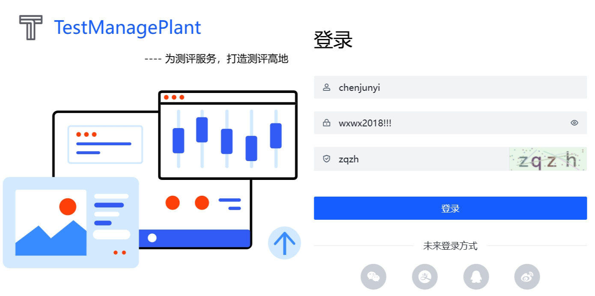
- 如果认证失败则会提示“账号或密码错误，如果是内网登录检查密码是否过期...”，那么请检查如下内容：
  - 内网密码是否过期，需要在内网windows里面更改密码后再次登录平台
  - 账户或者密码错误
    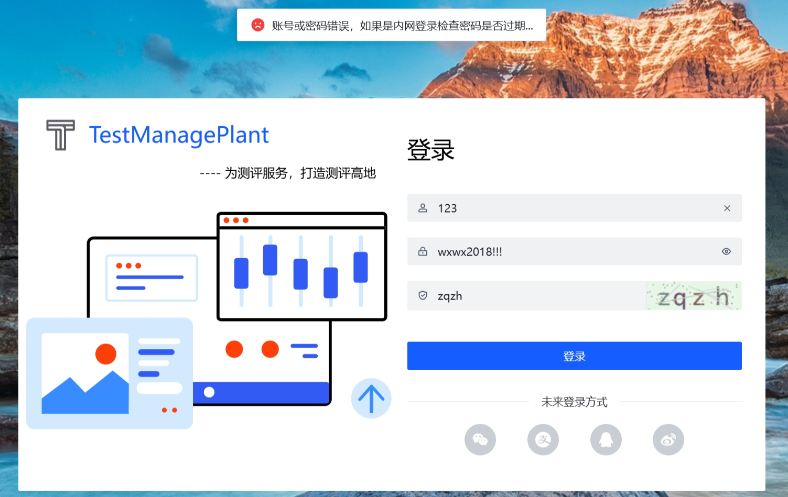
- 如果使用superAdmin管理员账号登录，登录成功，但是提示“加载LDAP用户错误”，表示您未连接内网环境或者LDAP服务器报错请检查是否连接内网环境

  

### 附带JWT认证

在内网LDAP认证方式情况下，平台附带进行JWT认证，默认访问token失效时间为**14小时**，默认刷新token失效时间为**1天**，请在失效前保存用户编辑内容。

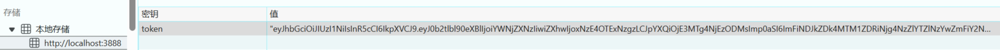

### 验证码

平台后台因为运行在内网或单机上，没有后端验证码验证，验证码均为前端JavaScript代码判断是否正确，在输入和图片一样的4个字符或数字后点击登录才能提交登录

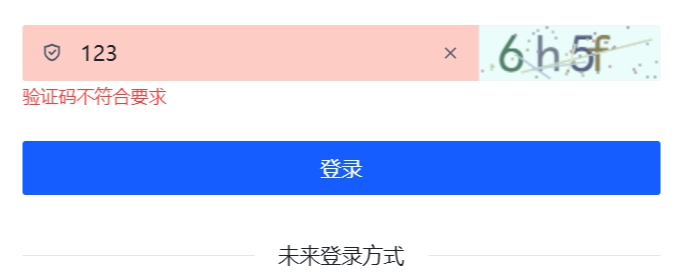

### 登录其他内容

1. 在每个用户登录后，平台会立即从LDAP服务器更新所有用户信息到平台数据库中
2. 平台有个管理员账户，具有全部权限，账号为superAdmin，密码为admin123，该账户用于单机或内网管理员进行使用
3. 登录页面“未来登录方式”未实现，目前点击无效，后续版本会删除按钮更换登录页面

## 2）顶部功能栏

顶部功能栏分为两个部分：

- 左侧是平台图标以及名称，主要提供一个从“工作区”→ 返回“平台主区域”的按钮，点击左上角图标或「测试管理平台」即可返回上次进入工作区的页面

  
- 右侧则是全局搜索、英文/中文界面切换、暗黑模式、全屏以及设置按钮，其中全局搜索、双语切换、设置功能还未实现
  - **暗黑模式**：点击即可切换平台样式主题，再次点击切换回来

    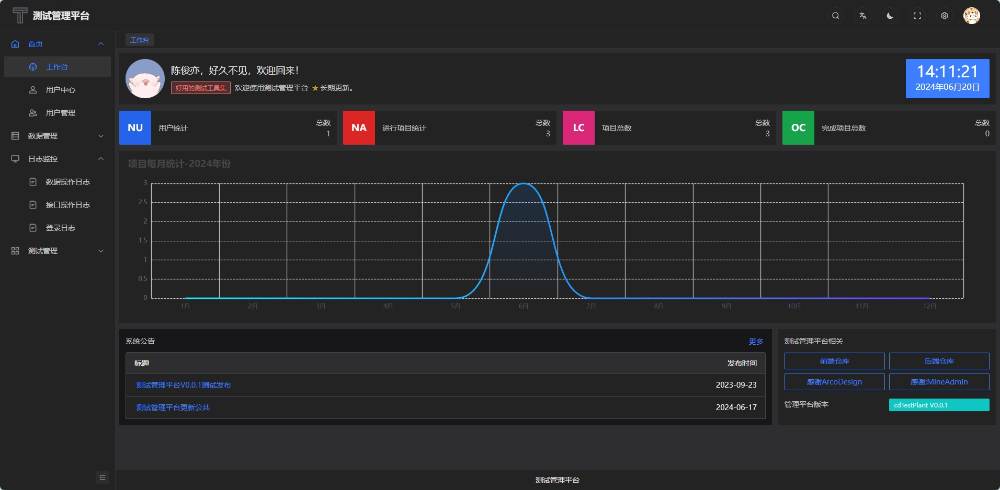
  - **全屏模式**：调用的是浏览器的全屏API，按“F11”进入或退出全屏
- 右侧头像下拉框包含切换角色、用户中心、用户设置、退出登录功能
  - **切换角色** - 目前没有该功能，在后续版本添加
  - **用户中心和用户设置** - 均跳转左侧菜单栏的“用户中心”页面
  - **退出登录** - 点击即可清除JWT的token本地储存，并返回登录页面

## 3）tab标签栏

tab栏主要将所有展示的页面用于用户快捷跳转，主要功能包括**右键标签页** → 重新加载、关闭当前标签页、关闭左侧标签页、关闭右侧标签页、关闭其他标签页、关闭全部标签页

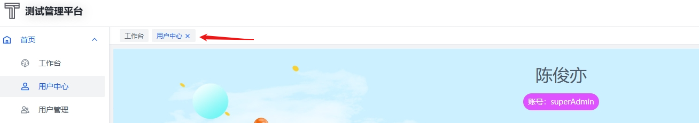

**说明：**

1. 主要功能和文字描述一致，标签页工作台是无法关闭的，常驻在tab标签栏上
2. 所有标签页**没有使用缓存**，在切换或刷新时，会重新请求后台数据，可以达到实时更新的作用

## 4）工作台（设计阶段）

工作台页面目前处于设计阶段，此处描述下目前版本的逻辑，包含实时时间显示、用户姓名展示、用户数目统计、进行项目统计、完成项目总数、项目每月统计（当前年份）、后台展示的公告文章、测试管理平台名称版本以及仓库外链

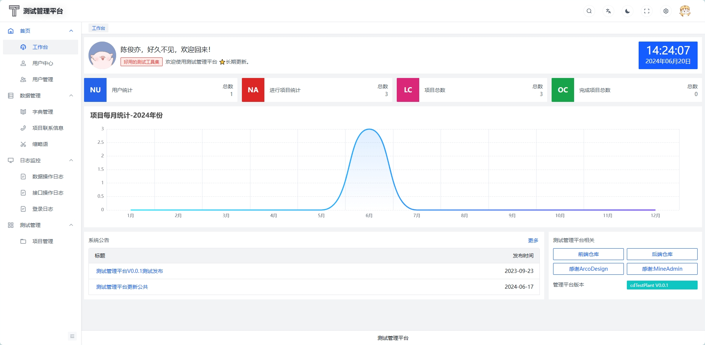

### 统计栏

主要分为两部分：

第一部分主要统计当前平台用户数量、进行中项目统计、项目总数、完成项目总数，分别在页面占据一格显示数量

第二部分是当前年份，以月份的形式展示**项目开始时间**所属的时间

### 公告栏（暂未完工）

目前公共栏为代码级别编写后台公告，后续版本会提供内容管理系统发布公告功能

### 其他信息

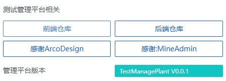

其他信息包含，其中外部链接点击会新建浏览器标签页打开该链接

1. 测试平台的名称、测试平台版本
2. 前端仓库、后端仓库的外部链接
3. 使用的框架或解决方案的外部链接

## 5）用户中心

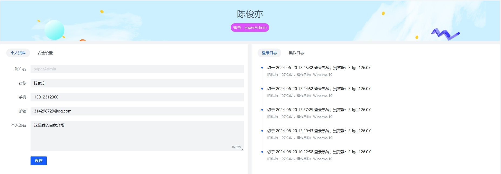

点击右上角头像 →「用户中心」或「用户设置」进入用户中心

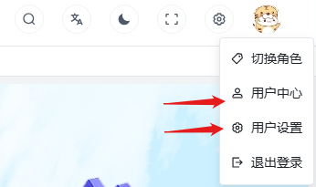

或者在菜单栏直接进入用户中心

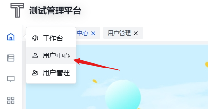

### 个人资料和安全设置

由于采用LDAP认证，和本平台的服务器无关，故个人资料和密码均不能修改，这里只是展示信息作用，后续版本会删除该部分

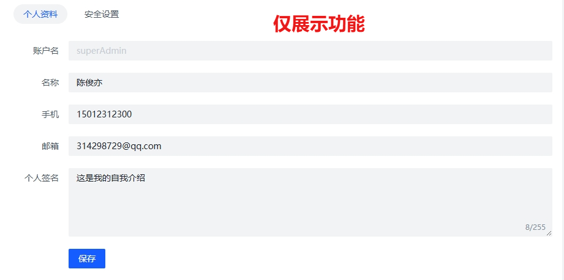

点击保存按钮，会响应统一的提示信息“由于采用LDAP登录无法修改!”

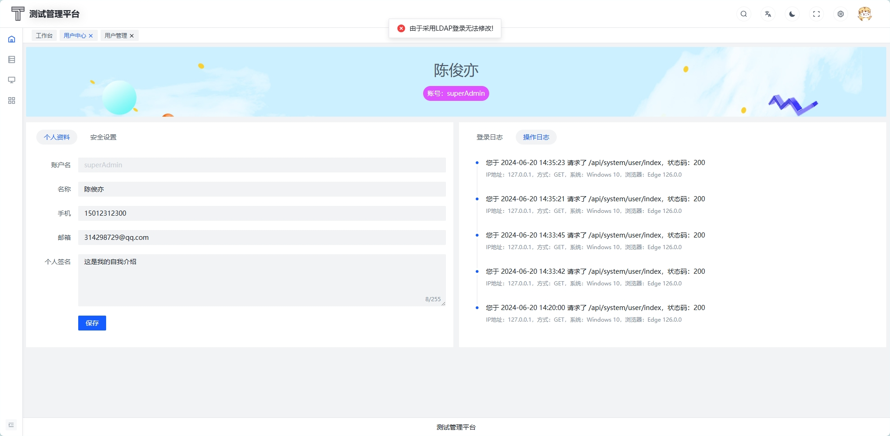

### 操作日志和登录日志

- 登录日志 - 保留最近5次的登录信息

  包含登录时间、使用的浏览器、IP地址、操作系统信息

  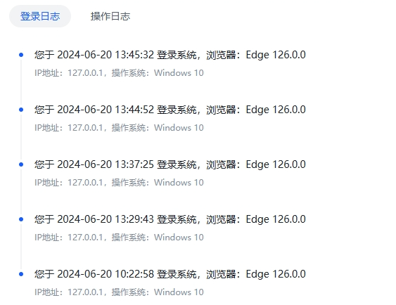
- 接口操作日志 - 保留最近5次后台接口访问的操作日志

  平台分为两种才做日志，第一种是“数据操作日志”，另一种则是本页面展示的“接口操作日志”，为最近5次的接口请求信息，包括请求时间、请求路径、响应状态码、IP地址、请求方式、系统和浏览器信息（包括内核版本）

  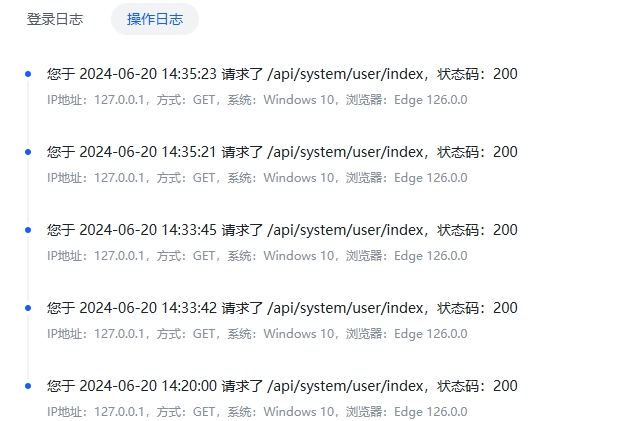

## 6）用户管理

### 权限问题

目前平台拥有全部权限为superAdmin账号，但是该账号无法编辑或删除自己

<!-- wolai-table:{"header":false,"columnWidths":[124,137,131,142,146]} -->

| 用户         | 创建用户 | 更新用户 | 删除用户 | 启动或停用用户 |
| ---------- | ---- | ---- | ---- | ------- |
| superAdmin | √    | √    | √    | √       |
| 普通用户       | ×    | ×    | ×    | ×       |

当superAdmin用户编辑/删除/查看自己信息时候，会弹出提示“创始人不可编辑,请关闭窗口”/“创始人不可删除”等提示

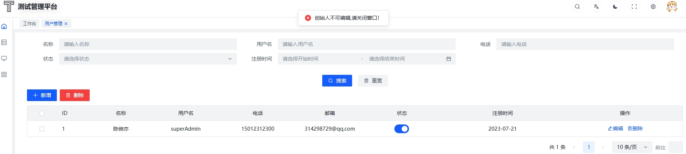

### 新增平台用户

以下用户操作功能均不和LDAP服务器相关，在用户管理界面点击「新增」按钮，打开弹窗

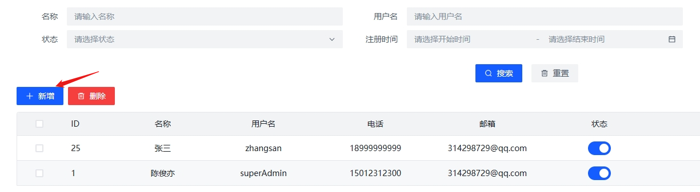

在「新增」弹窗中，定义名称、用户名、密码、电话、邮箱，其中用户名和密码和登录关联

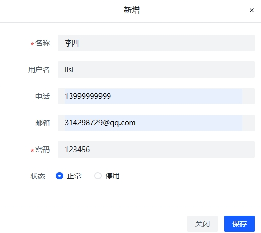

在「新增」弹窗中，状态分为“正常”和“停用”，当用户状态为“停用”时，该用户无法登录平台

也可以在表格直接修改用户状态

> 请不要连续修改状态，因为表格开启了双击编辑功能

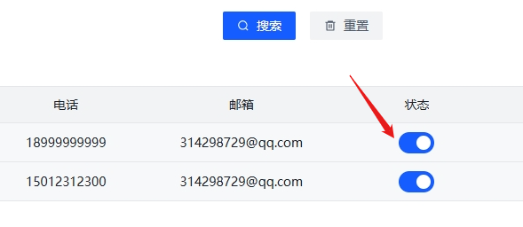

### 编辑用户

同新增用户，保存后更新数据

### 删除用户

点击表格操作列或选择表格多选点击「删除」按钮即可删除，注意superAdmin不能删除

## 7）字典管理（设计阶段）

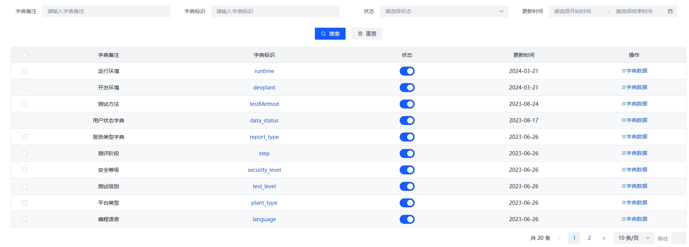

进入字典管理页面，点击表格列「字典标识」或操作列「字典数据」，进入该字典字段的详细页面

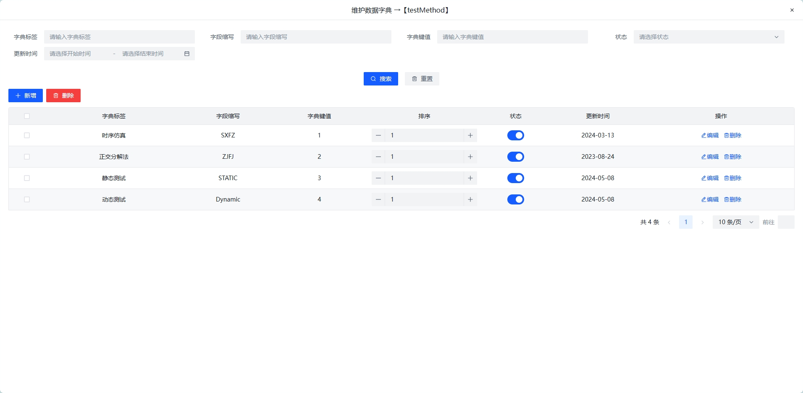

### 描述

字典管理，功能主要是对系统中经常使用并且固定的数据可以重复使用和维护

字典管理，相关字典字段**不允许新增/删除**，字段中的数据**可新增/编辑/删除**，字典字段总数20个，如下所示【注意带\*为生成文档强相关内容】：

<!-- wolai-table:{"header":false,"columnWidths":[124,126,481]} -->

| 字典标识            | 字典名称     | 数据使用位置                                                        |
| --------------- | -------- | ------------------------------------------------------------- |
| runtime         | 运行环境     | 单个项目数据，软件的运行环境，决定生成大纲、说明、报告文档中的“被测软件信息表格”中的运行环境（可新增/删除/启用/禁用） |
| devplant        | 开发环境     | 同上（可新增/删除/启用/禁用）                                              |
| testMethod      | 测试方法     | 关联测评大纲测试项中测试方法内容（可新增/删除/启用/禁用）                                |
| data\_status    | 用户状态字典   | 关联平台用户管理的启用停止的显示内容，修改后用户管理→显示的启用禁用状态会根据修改的内容而变化               |
| report\_type    | 报告类型字典\* | 关联项目类型，例如“鉴定测评报告”，和生成文档强相关（目前还未做：不能删除修改和新增，需要管理员决定）           |
| step            | 测评阶段     | 项目状态：该功能目前只影响“工作台”项目统计                                        |
| security\_level | 安全等级     | 项目的安全等级（可新增/删除/启用/禁用）                                         |
| test\_level     | 测试级别     | 项目的级别：目前没有其他功能关联                                              |
| plant\_type     | 平台类型     | 项目的平台类型：软件是在哪个平台运行的，目前无功能关联                                   |
| language        | 编程语言     | 项目使用的编程语言：仅项目数据，无其他功能关联                                       |
| standard        | 测试标准     | 项目使用的测试标准：例如438C，决定大纲、报告中依据文档                                 |
| demandType      | 需求类型\*   | 设计需求的类型，决定生成文档的描述内容（用户尽量不修改）                                  |
| priority        | 优先级      | 测试项关联的优先级，仅决定生成大纲文档中的测试项优先级选项                                 |
| testType        | 测试类型\*   | 测试项的测试测试类型，例如功能测试、接口测试，和生成文档排序，文档描述强相关                        |
| passType        | 通过类型\*   | 用例步骤的类型，尽量不要修改，和统计数据、页面展示强相关                                  |
| execType        | 用例执行情况\* | 用例步骤的执行情况，尽量不要修改，和统计数据、页面展示、生成文档强相关                           |
| problemStatu    | 问题状态     | 问题是否闭环等状态，目前只跟页面展示有关，可看问题是否闭环                                 |
| problemType     | 问题类型\*   | 问题报告单中的问题类型，和生成文档强相关，建议不要更改                                   |
| problemGrade    | 问题级别\*   | 问题报告单中的问题级别，和生成文档强相关，建议不要更改                                   |
| closeMethod     | 问题闭环方式\* | 问题报告单中的问题闭环方式，和生成文档强相关，建议不要更改                                 |

### 字段数据管理

以运行环境为例，点击字典数据进入字段数据页面

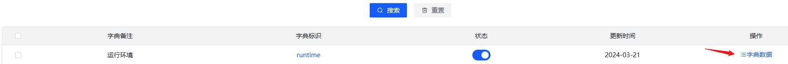

字典标签决定后续操作的选项，字段缩写目前无用，也可更改排序以及状态

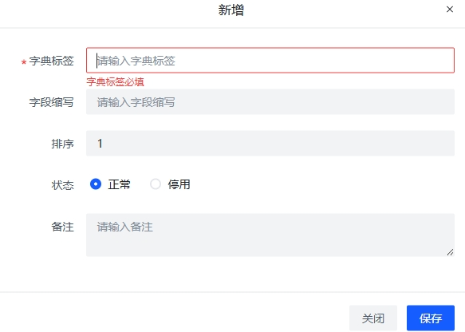

字典标签具有判重功能，同样的标签无法新增

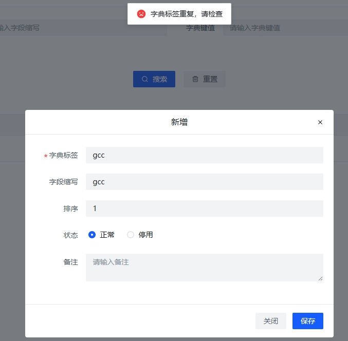

### 如何决定后续选项

当添加“运行环境”字典数据，新增“树莓派”

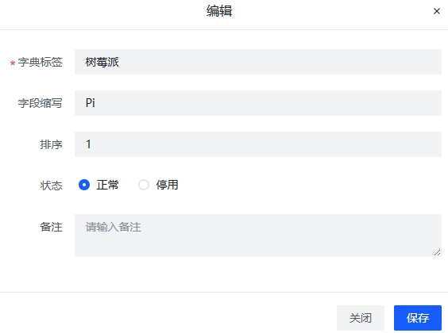

这时再次进入“项目管理”页面，点击「编辑」或双击查看项目信息，可以看到运行环境下拉框多出一个新增的“树莓派”选项

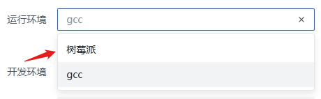

### 字典的设计缺陷

目前像testType（测试类型）、report\_type（报告类型）等字典字段，千万不要修改，因为决定后续整体生成文档的正确性，这是一个设计缺陷，会在后续版本中进行尝试性修复

## 8）项目联系信息

点击菜单栏「项目联系信息」，可查看录入的所有联系人信息，为数据关联信息

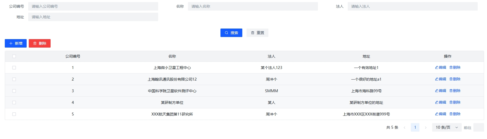

### **录入字段**

- 公司编号：具有判重
- 名称 - 必填
- 法人 - 必填
- 地址 - 必填

### **关联数据**

1. 项目数据：委托方信息、研制方信息、测评中心信息

   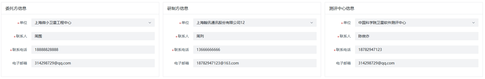
2. 被测件信息：单位

   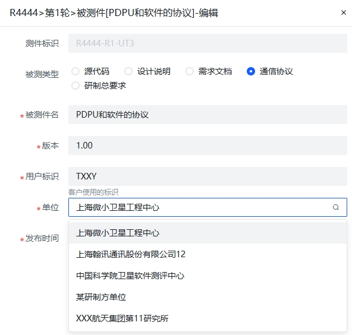

## 9）缩略语

关联“项目”数据中的缩略语字段，在此处新增/删除

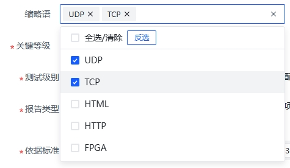

## 10）日志

本平台日志分为三种，分别为数据操作日志、接口操作日志、登录日志

日志信息均不能新增/编辑，只能查看，提供了删除接口，可根据“距现在时间的天”分别提供“删除7天前数据”和“删除全部日志”，注意：删除日志后**无法恢复**

### 登录日志

点击菜单栏「日志监控」-「登录日志」，进入登录日志界面，可查看当前登录用户的**全部**日志信息

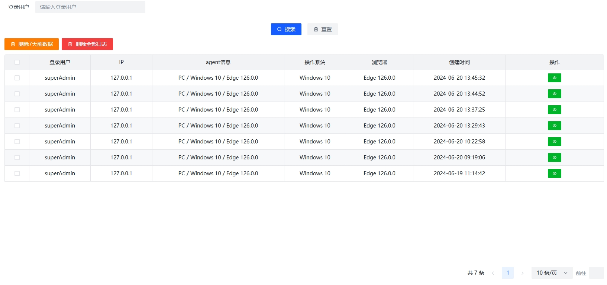

日志信息包括：

- 登录用户
- IP
- 客户端信息
- 操作系统
- 浏览器
- 日志记录时间

搜索列仅包含“登录用户”字段

可以点击操作列“”按钮进行查看详情，当前详情暂定是表单

因为是表单格式，点击「保存」按钮，会提示“该详情只能查看”

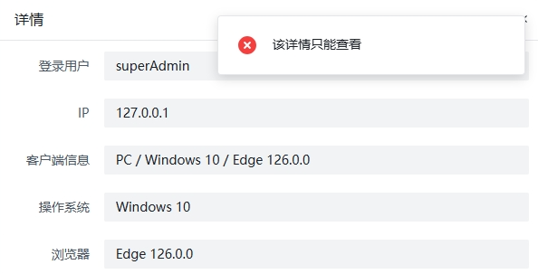

### 数据操作日志

数据操作日志，可查看到是哪个用户进行对数据库储存数据的所有操作的记录，便于追踪结构化数据变化

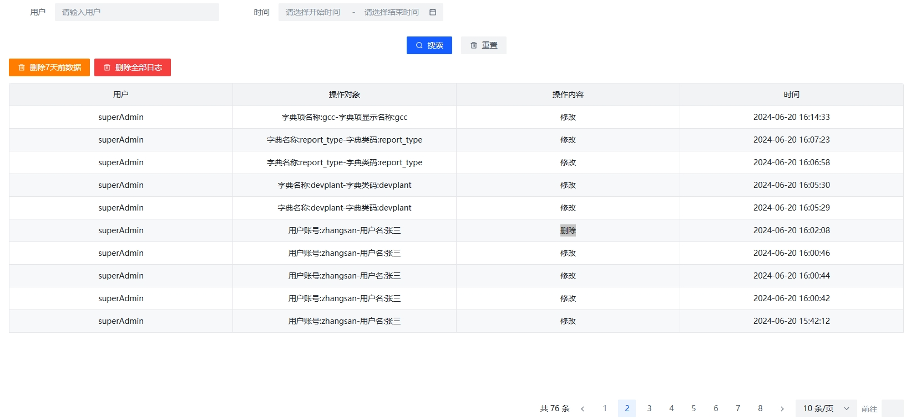

日志信息包括：

- 用户账号
- 操作对象 - 显示为“数据表名称：数据表记录”
- 操作内容 - 分为“新增”和“修改”、“删除”
- 时间

### 接口操作日志

接口操作日志，区别于“数据操作日志”，主要可以查看是哪个用户请求了后端什么接口，以及响应数据的情况

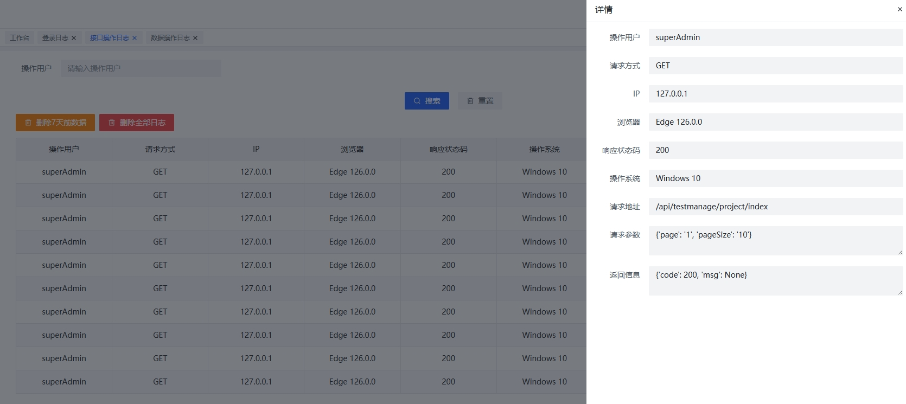

日志信息包括：

- 操作用户
- 请求方式：例如‘GET’‘POST’‘PUT’‘DELETE’等
- IP地址
- 浏览器
- 响应状态码
- 操作系统
- 请求地址
- 请求参数
- 返回信息

可以点击操作列“”按钮进行查看详情，当前详情暂定是表单

因为是表单格式，点击「保存」按钮，会提示“该详情只能查看”

## 11）项目管理

项目管理是平台工作的主要入口，点击菜单栏「项目管理」展示项目管理表格

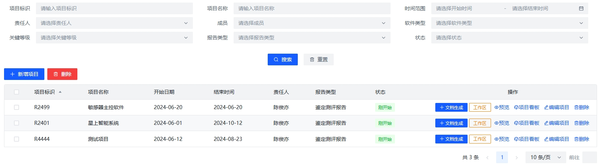

项目管理表格只显示如下项目数据信息：

- 项目标识
- 项目名称
- 开始日期
- 结束日期
- 责任人
- 报告类型
- 状态（根据字典数据而定）
- 操作列 - 包含文档生成、工作区、预览、项目看板、编辑项目、删除按钮

### 文档模版和片段

一个项目创建/删除决定了服务器根目录下面/media文档模版库和片段库，当新建一个项目时，对应会在/media文档下的文件，目录命名为“项目标识”

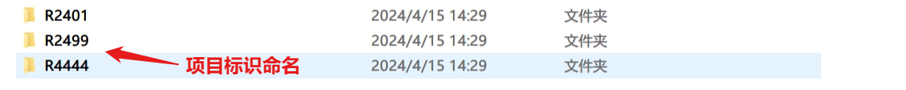

用户可进入目录对文档模版和片段库进行修改/锁定等操作，后面有详细介绍

### 预览功能

点击项目表格中操作列「预览」可进入打开预览弹窗

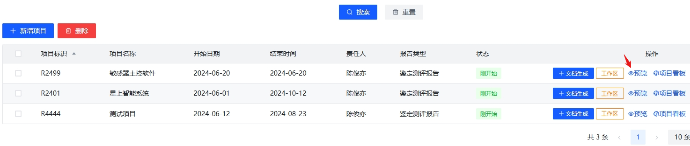

在预览弹窗中，展示了该项目的数据，数据和新增/编辑项目的数据一致

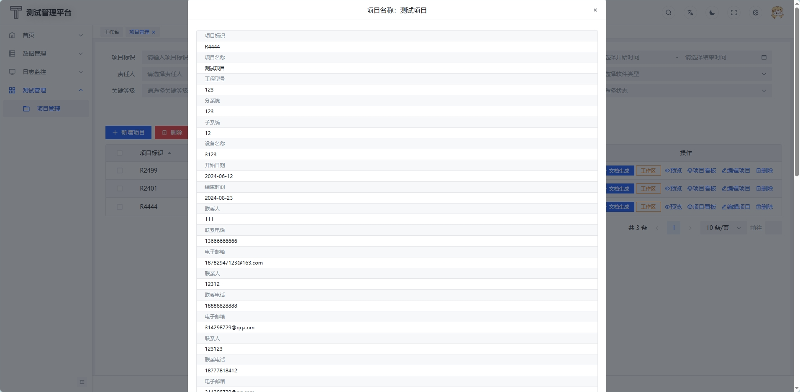

### 项目看板

为了了解该项目整体信息，点击「项目看板」可以跳转项目看板页面

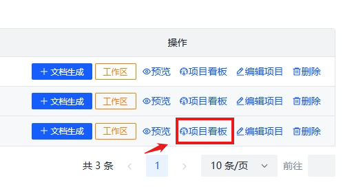

该页面展示所属项目一些统计信息，点击左上角“<”符号可以返回项目管理页面

项目看板包含数据分3部分：

- 基本信息 - 主要有时间、人员、开发方信息、用例统计、问题统计

  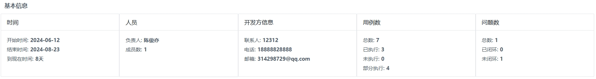
- 项目时间轴 - 主要为用户填写的项目开始时间、结束时间、轮次开始时间和结束时间

  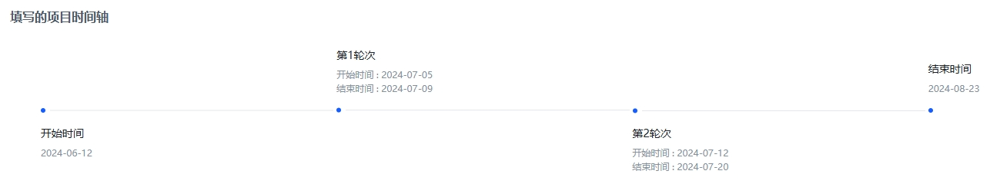
- 每轮次统计信息 - 该轮次设计需求的测试项/用例统计信息，测试类型下测试项/用例统计信息

  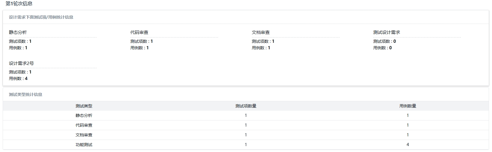

### 新增项目

打开「项目管理」，点击「新增项目」按钮，可新增项目：

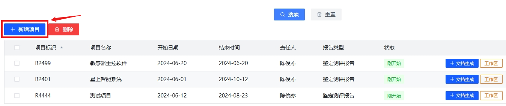

在新增项目弹窗中，填写如下字段：

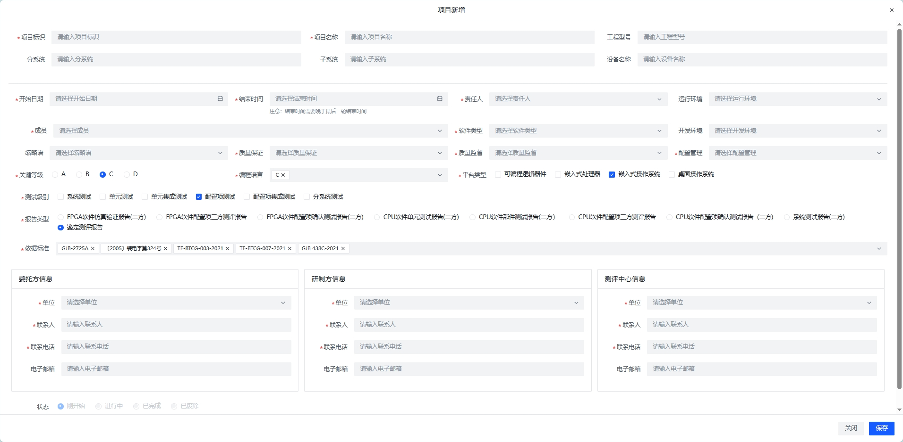

#### 字段详细

1. **项目标识**：必填，关联/media下创建的目录，项目的唯一标识，要求和测评中心体系中项目标识一致，关联生成文档的文档名称、文档标识等
2. **项目名称**：必填，项目的名称，要求和测评中心体系的项目标识一致，关联生成文档名称、文档标识等
3. 工程型号：目前无关联
4. 分系统：目前无关联
5. 子系统：目前无关联
6. 设备名称：目前无关联
7. **开始日期**：必填，该时间信息强关联诸多信息，详情间时间关联说明
8. **结束日期**：必填，用户填写时带“结束时间>开始日期”的验证规则，其他关联信息查看附录
9. **责任人**：必填，备选数据为用户数据，关联生成多个文档的编制人员、大纲和报告的负责人
10. 运行环境：关联大纲、说明和报告中被测软件信息表
11. **成员**：必填，关联大纲、报告中测试团队组织结构
12. **软件类型**：必填，关联大纲、报告中被测软件信息表
13. 开发环境：关联大纲、报告中被测软件信息表
14. 缩略语：仅关联大纲、报告的缩略语附录
15. **质量保证**：必填，关联大纲、报告“测评组织及任务分工”
16. **质量监督**：必填，关联大纲、报告“测评组织及任务分工”
17. **配置管理**：必填，关联大纲、报告“测评组织及任务分工”
18. **关键等级**：必填，关联测评项目（软件）的关键等级
19. **编程语言**：必填，关联“被测软件基本信息表”
20. 平台类型：必填，暂时无关联
21. 测试级别：必填，暂时无关联
22. **报告类型**：必填，注意该字段仅分为“鉴定”和“普通”，鉴定文档会在多个地方和普通文档有所区别：
    - 文档名称 - 例如：XXX软件鉴定测评大纲/XXX软件测评大纲
    - 测评性质 - 例如：本次测评任务为鉴定测评/第三方测评
    - 测评目的 - 鉴定需要添加“是否符合作战使用要求，为装备状态鉴定提供依据”等说明
    - 主要战技指标 - 鉴定在大纲、报告中需要新增章节“主要战技指标”
    - 研制总要求追踪 - 鉴定需要新增章节附录“测试项和研制总要求对照表”
    - 平台被测件 - 鉴定需要在平台上添加“研制总要求”被测件
23. **依据标准**：必填，平台默认在新增项目填写如下：

    可在字典管理里面新增
    1. GJB-2725A
    2. \[2005]装电字第324号
    3. TE-BTCG-003-2021
    4. TE-BTCG-007-2021
    5. GJB-438C-2021
       该字段信息关联大纲、说明、回归说明、报告中的“标准类引用文档”：
    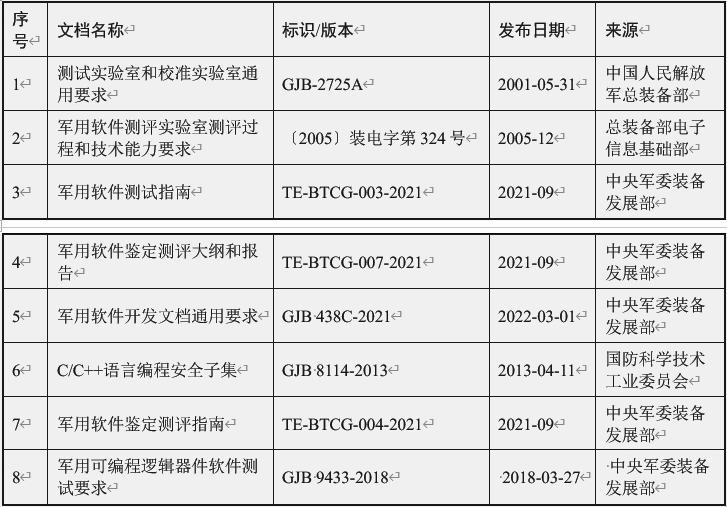
24. 委托方信息/研制方信息/测评中心信息 - 关联大纲、报告中：
    1. 委托机构的名称与联系方式
    2. 承研单位的名称与联系方式
    3. 测评机构的名称与联系方式
       可在菜单栏的“项目联系信息”中维护字典数据
25. 状态 - 暂时无作用（待设计）

## 附录

### 附录1时间关联说明（暂定）

在生成文档中，有诸多时间信息

用户只录入如下时间，平台在生成文档时自动填写，用户需要录入字段有：

- 项目开始时间
- 项目结束时间
- 每个轮次开始时间
- 每个轮次结束时间

#### 相关时间

- 大纲编制开始时间 - 项目开始时间+1天
- 大纲编制结束时间 - 大纲编制开始时间+6天
- 测评设计与实现开始时间 - 大纲编制结束时间+1天
- 测评设计与实现结束时间 - 测评设计与实现开始时间+5天
- 其中每个文档的拟制时间、校对时间、审核时间、批准时间、文档创建时间、文档v1版本时间 → 均以封面时间为基准
  - 拟制时间 - 封面时间-2天
  - 校对时间 - 拟制时间+1天
  - 审核时间 - 封面时间
  - 批准时间 - 封面时间
  - 文档创建时间 - 封面时间-2天
  - v1版本时间 - 封面时间

#### 大纲

- 封面时间 - 大纲编制结束时间
- 被测件接收时间 - 项目开始时间\~项目开始时间

#### 说明

- 封面时间 - 为“测评设计与时间”的结束时间

#### 记录

- 封面时间 - 为第一轮次用户填写的结束时间
- 用例执行时间 - 为工作区用户填写的执行时间

#### 回归说明

- 封面时间 - 每个轮次用户填写的开始时间

#### 回归记录

- 封面时间 - 每个轮次用户填写的结束时间
- 用例执行时间 - 为工作区用户填写的执行时间

#### 报告

- 封面时间 - 为项目结束时间
- 测评总结时间 - 项目结束时间-7天\~项目结束时间
- 测评需求分析时间 - 大纲编制开始时间\~大纲编制开始+2天
- 测评策划时间 - 测评需求分析结束时间+1天\~大纲编制结束时间
- 测试设计和实现时间 - 为大纲测试设计开始时间\~大纲测试设计结束时间
- 测试执行时间 - 按每个轮次用户填写开始时间\~用户填写结束时间
