# 2.工作区

## 目录

- [1）初次进入工作区](#1初次进入工作区)
  - [自动检测源代码被测件](#自动检测源代码被测件)
    - [强制弹窗](#强制弹窗)
    - [自动创建静态测试内容](#自动创建静态测试内容)
  - [节点搜索功能](#节点搜索功能)
  - [树状目录懒加载和展开按钮](#树状目录懒加载和展开按钮)
- [2）轮次节点](#2轮次节点)
  - [新增轮次三种方式](#新增轮次三种方式)
    - [方式一：创建项目自动创建](#方式一创建项目自动创建)
    - [方式二：点击复制创建轮次按钮](#方式二点击复制创建轮次按钮)
    - [方式三：点击轮次节点右侧的「+」](#方式三点击轮次节点右侧的)
  - [编辑轮次](#编辑轮次)
  - [删除轮次](#删除轮次)
  - [右键“查看轮次下问题单”](#右键查看轮次下问题单)
- [3）被测件节点](#3被测件节点)
  - [概念](#概念)
  - [最应该添加的被测件](#最应该添加的被测件)
  - [点击蒙层关闭弹窗](#点击蒙层关闭弹窗)
- [4）设计需求节点](#4设计需求节点)
  - [概念](#概念)
  - [富文本输入和解析](#富文本输入和解析)
  - [新增](#新增)
    - [填写表单形式新增](#填写表单形式新增)
    - [上传需求规格说明快捷录入（设计中...）](#上传需求规格说明快捷录入设计中)
  - [关于设计需求标识](#关于设计需求标识)
- [5）测试项](#5测试项)
  - [新增](#新增)
  - [修改](#修改)
  - [删除](#删除)
  - [特殊功能-关联测试项](#特殊功能-关联测试项)
  - [树状目录右键-根据测试子项生成用例](#树状目录右键-根据测试子项生成用例)
  - [树状目录右键-复制到设计需求下](#树状目录右键-复制到设计需求下)
  - [树状目录测试项的拖拽](#树状目录测试项的拖拽)
  - [6）测试用例](#6测试用例)
  - [新增](#新增)
  - [CRUD显示执行情况和通过情况](#CRUD显示执行情况和通过情况)
  - [树状目录符号逻辑-显示用例和问题单关系](#树状目录符号逻辑-显示用例和问题单关系)
  - [拖拽功能](#拖拽功能)
    - [用例拖拽到测试项节点](#用例拖拽到测试项节点)
  - [用例拖拽到其他用例节点的前后](#用例拖拽到其他用例节点的前后)
- [6）问题单](#6问题单)
  - [新增](#新增)
  - [取消关联](#取消关联)
- [工作区返回项目管理页面](#工作区返回项目管理页面)
- [附录](#附录)
  - [附录1强制弹窗源代码被测件创建的信息](#附录1强制弹窗源代码被测件创建的信息)
  - [附录2上传需求文档解析为设计需求预录入数据规则](#附录2上传需求文档解析为设计需求预录入数据规则)

工作区是测试人员工作录入数据的区域，在项目管理中点击一个项目的「工作区」，即可跳转工作区页面

工作区页面分为左侧和右侧部分，**左侧**主要是以树状目录结构显示当前项目的全部结构化数据目录，**右侧**则是以CRUD表格显示所属下级节点的全部信息

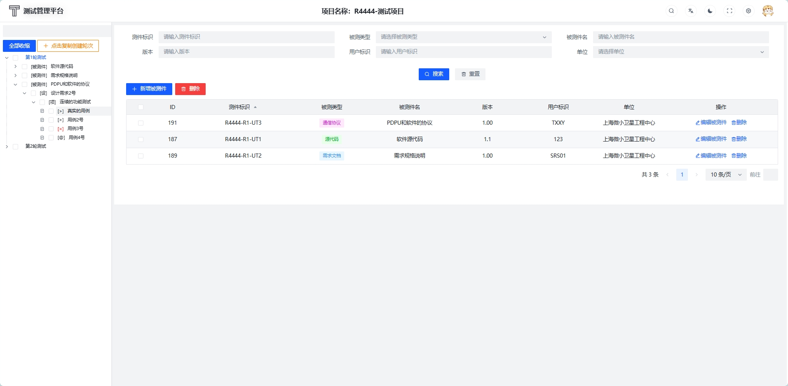

整个项目结构数据分级为：

**项目→轮次→被测件→设计需求→测试需求（测试项）→测试用例→问题单**

其中测试需求（测试项）还包含测试子项，测试用例还包含测试步骤

## 1）初次进入工作区

由于项目必须存在第一轮测试，故程序会帮你**自动**创建第一轮测试节点

用户需要点击树状目录轮次节点右侧的「」按钮进行修改：特别是**开始时间**和**结束时间**

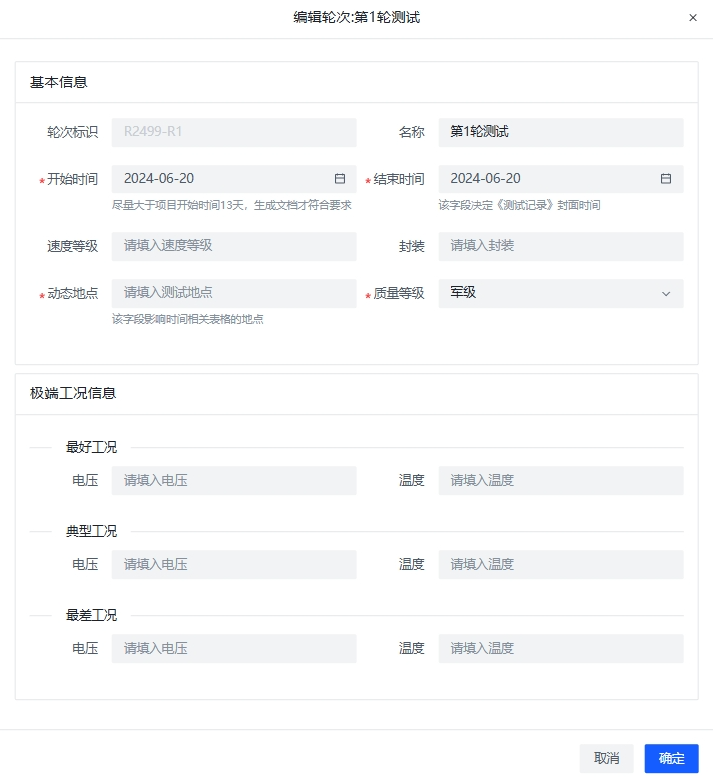

### 自动检测源代码被测件

#### 强制弹窗

程序会在用户每次进入工作区时检测**每一轮**测试节点是否包含源代码被测件，如果没有则会弹窗强制创建源代码被测件（dut），当然这时也可以点击「返回项目页面」返回项目管理，下一次进入工作区时也会强制弹窗，直到每一轮测试节点下面包含源代码被测件（dut）

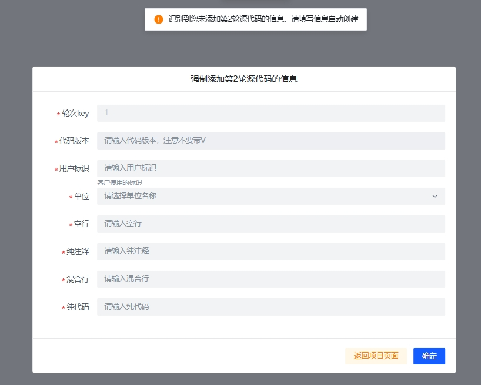

相关字段：

- 轮次key：不能修改，由系统自动创建
- 代码版本：必填，版本写法按照实际项目进行填写，不要加“V”
- **用户标识**：必填，这是研制方对代码标识的版本，如果客户未提供请先随意填写
- **单位**：必填，关联「首页」-「数据管理」-「项目联系信息」
- 空行：必填，代码空行数
- 纯注释：必填，代码纯注释行数
- 混合行：必填，代码混合行数
- 纯代码：必填，代码的纯代码行数

对于源代码被测件，程序会根据上面4个行数计算出测评报告所需要的注释率等信息

#### 自动创建静态测试内容

在弹窗创建完毕轮次的“软件源代码”被测件后，会自动将三种测试类型的“设计需求”、“测试项”（包含子项）、“用例”（包含步骤）也一并创建，具体创建数据**见附录1**，可联系管理员配置

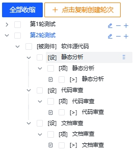

### 节点搜索功能

在树状目录上方有搜索功能，模糊匹配节点的名称，搜索空字符串则显示全部节点

> 搜索字符串空格会被自动清除

### 树状目录懒加载和展开按钮

单击树状目录节点，会在右侧展示所属节点信息，通过右侧CRUD界面对子节点进行新增/编辑/删除等操作

双击或点击节点左侧箭头会远程加载节点所属节点信息，该数据为**懒加载**，即前端页面不会立即读取项目全部节点，而是用户展开时候进行远程获取，此为懒加载逻辑

因为是懒加载节点数据，所以展开和收缩按钮则只会影响已加载数据，F5刷新后也可储存，如果遇到“虚假节点”，则请回到项目管理页面刷新页面后再进入工作区

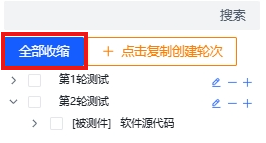

## 2）轮次节点

### 新增轮次三种方式

#### 方式一：创建项目自动创建

请看前面说明

#### 方式二：点击复制创建轮次按钮

平台提供对树状目录节点的复选框勾选功能，用户勾选节点的复选框，被勾选的节点以及子节点会在用户点击「点击复制创建轮次」按钮确认后自动创建下一个轮次信息

点击「确认」后，将本轮次节点以及全部子节点复制到下一个轮次中，注意：被复制的节点和子节点数据完全一致，请复制后立即更新节点信息

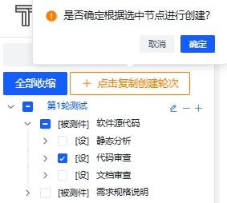

被复制到下一轮后

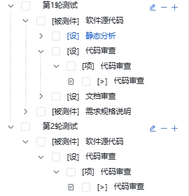

#### 方式三：点击轮次节点右侧的「+」

仅轮次节点右侧有「+」「-」「」按钮，分别代表新增轮次、删除轮次、修改轮次

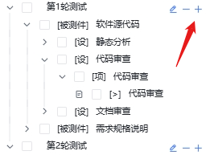

点击「+」后会轮次新增弹窗

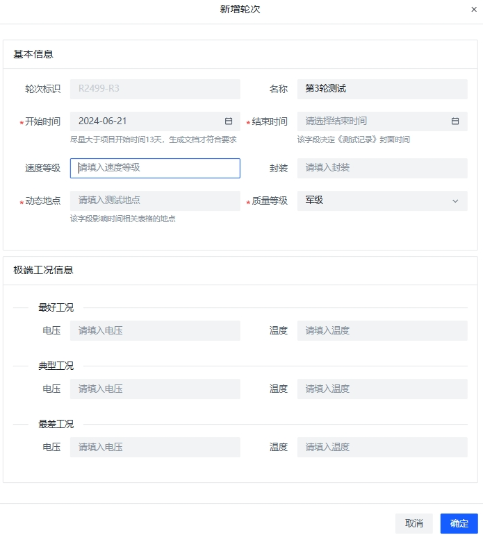

相关字段：

- 轮次标识：系统自动生成，不能编辑
- 名称：尽量由系统生成，不推荐修改
- **开始时间**：必填，关联生成回归测试说明和回归测试记录以及报告的时间信息
- **结束时间**：必填，同上
- 速度等级：暂无关联
- 封装：暂无关联
- **动态地点**：必填，为该轮次动态测试的地点
- 质量等级：必填，暂无关联
- 极端工况情况：暂无关联，后续版本会根据FPGA进行适配性研发

填写有关信息后点击「确定」按钮即可新增一轮测试，这时会强制弹窗，因为新一轮测试没有“源代码被测件”

### 编辑轮次

点击\[]即可编辑轮次，点击「确定」可更新信息

### 删除轮次

注意删除轮次会删除轮次下面所有节点信息，请谨慎

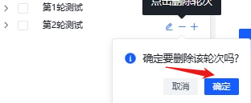

### 右键“查看轮次下问题单”

新增、修改、删除件问题单章节

右键“轮次节点”，弹出下拉框，选择查看轮次下问题单

点击按钮，即可查看该轮次所有的问题单，该弹窗的作用是让用户可以不在测试用例的节点上新增问题单，可以创建无关联用例的问题单，并在生成文档之前进行关联

## 3）被测件节点

### 概念

被测件节点是指一个项目中研制单位提供的需求载体，例如“需求规格说明”、“通信协议”、“源代码”、“研制总要求”等，平台规定该节点是轮次节点下的必要节点，用于承载平台生成文档的“引用文档”、“文件版本”、“源代码”等信息

### 最应该添加的被测件

在项目创建后，应该添加“需求规格说明”被测件，点击树状目录“第1轮次”，右侧显示轮次下面的所有被测件子节点

点击「新增被测件」按钮，弹出新增被测件窗口，被测类型选择“需求文档”

表单数据会根据被测件类型进行调整，分为两个逻辑，源代码被测件比其他被测件多出“空行”“纯代码行”“纯注释行”“混合行”和非用户填写的“注释率”，非源代码被测件则多出“发布时间”字段，该字段影响生成文档中的引用技术类文档的“时间”

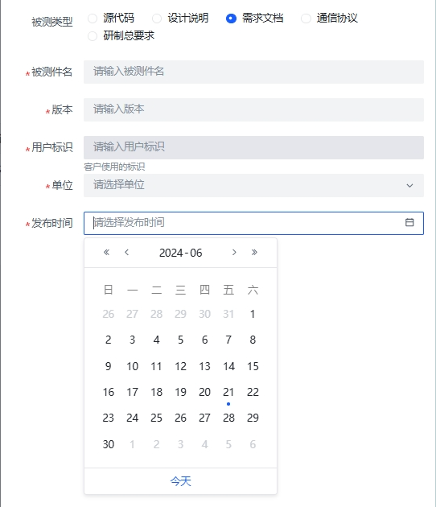

相关字段：

- 被测件名：必填，填写“需求规格说明”，生成文档会自动前面填充项目名称
- 版本：必填，不要带“V”
- 用户标识：必填，需求规格说明真实的研制方提供的标识
- 单位：必填，关联「首页」-「数据管理」-「项目联系信息」
- 发布时间：上面本节已说明

填写完有关信息后，点击「保存」，则“第1轮测试”页面下显示新增的需求规格说明

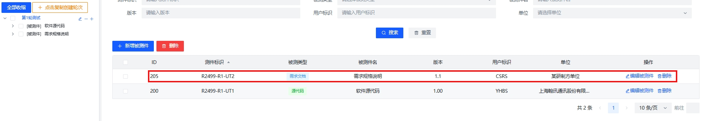

### 点击蒙层关闭弹窗

默认情况下，所有右侧表格的表单弹窗均可以点击蒙层关闭弹窗，除“被测件”新增/编辑弹窗外，这是因为被测件右侧抽屉占据面积小，防止用户点击蒙层数据立即丢失

用户可以点击右上角「X」或者「关闭」按钮关闭抽屉

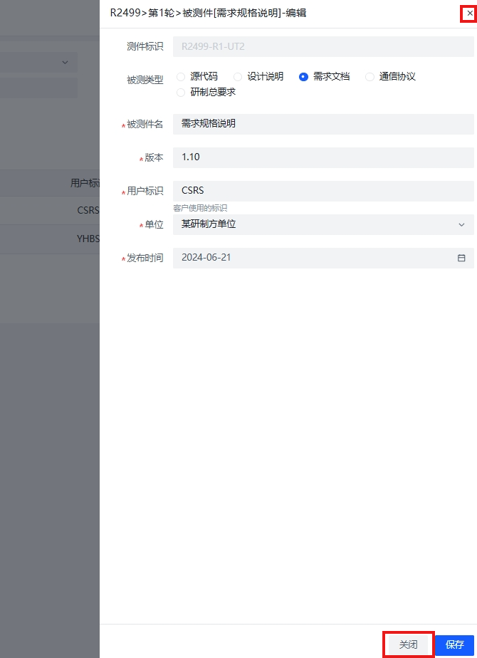

## 4）设计需求节点

### 概念

设计需求不是测试需求也不是测试项，而是测试项关联的被测件里面原封不动的需求描述，主要承载研制方提供的被测件文档中描述的“设计需求标识”、“设计需求名称”、“设计需求章节号”、“需求类型”以及需求描述，对应大纲文档中测试项的**需求描述**以及**其他文档的追踪关系**

### 富文本输入和解析

设计需求的需求描述栏，平台因为要规范用户输入，仅支持以下**三种格式**的数据输入：

- word表格：用户可直接复制word表格到富文本编辑器里，平台可将图片生成到二级文档、最终文档中
- 纯文本：在生成文档时，正常生成，注意换行
- 图片：支持截图直接粘贴到富文本编辑框，也支持嵌入生成文档中

### 新增

#### 填写表单形式新增

点击「新增设计需求」，弹出表单

相关字段：

- 设需标识：需求文档中定义的标识，是研制方写的标识，非必填可能研制方没有
- 设需名称：必填，按照需求文档的名称直接填写
- **章节号**：非必填，按照需求文档的章节号填写，没有章节号则建议填“/”，关联生成文档中所有的**追踪关系**，例如静态分析、代码审查则章节号应该填“/”或者“隐含需求”

填写表单结束后，用户输入数据验证结束后点击保存，则新增了个测试需求，可继续点击「新增设计需求」新增设计需求

#### 上传需求规格说明快捷录入（设计中...）

点击「上传需求规格说明快捷录入」，弹窗“批量需求导入”

为了方便录入需求快捷，平台提供一个页面可以上传需求规格说明文件，平台解析文件后将录入设计需求的项以“分页”方式展示给用户，用户可新增/编辑/删除来筛选出正确、补充设计需求

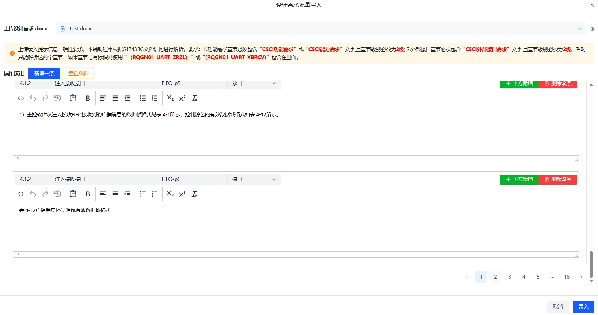

> 需求规格说明的解析规则在附录2中

点击「点击上传」，选择需求规格说明文档，会立即解析并分页显示所有解析出的设计需求，顶部会显示上传的文件名称以及状态

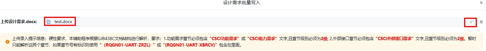

点击「」，可以清除当前文档上传数据以及设计需求预览数据

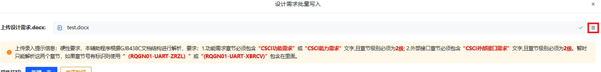

点击「重置数据」，则会清空所有设计需求预录入数据

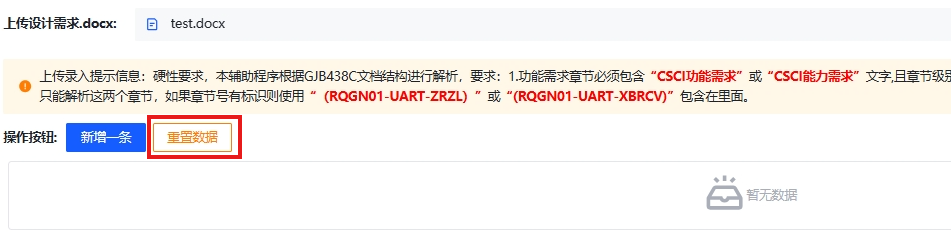

点击「新增一条」，则会在设计需求预录入数据的末尾新增一条空数据，用户可以自己录入设计需求信息

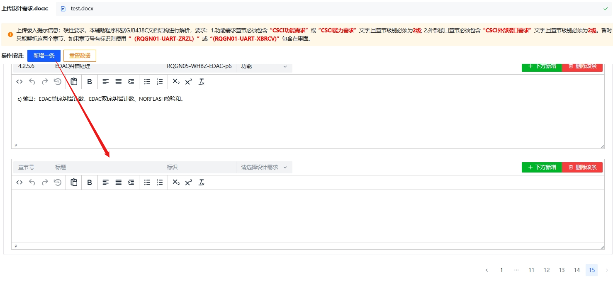

每条设计需求预录入数据字段包含“章节号”“标题”“标识”“设计需求类型”以及富文本框“需求描述”，同样的富文本输入框仅支持三种【纯文本、图片、word表格】

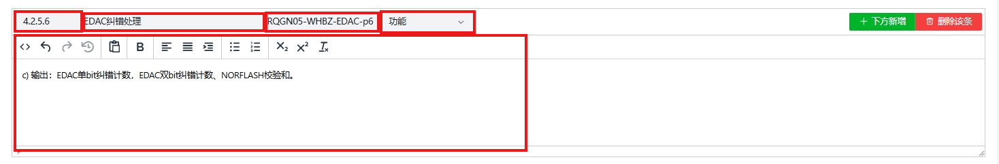

用户也可在特定位置插入设计需求预录入数据，以及删除单条预录入数据，注意删除的预录入数据不可恢复

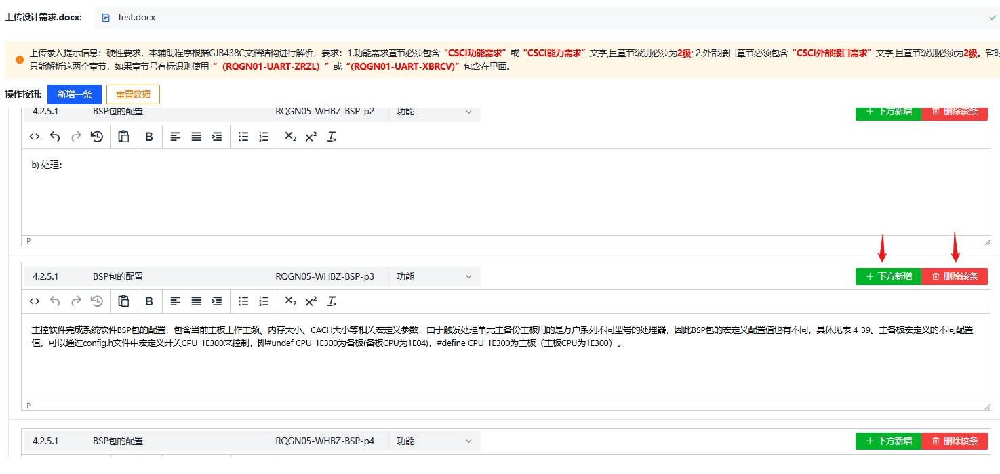

### 关于设计需求标识

设计需求标识以“SJ-设计需求类型-用户标识”显示，目前生成文档无关联数据，故不用纠结于此

## 5）测试项

测试项即对应测评大纲的测试项，是一一对应的关系

点击树状目录的设计需求节点，即可查看所属的所有测试项

### 新增

在设计需求节点右侧CRUD界面，点击「新增测试项」打开弹窗进行新增，字段如下：

- 测项名称：必填，对应大纲测试项的标识，类似于“XQ\_FT\_XXXX”，XXXX即为测试项标识
- 名称：必填，测试项的名称，例如“初始化功能测试”
- 优先级：对应大纲测试项的优先级
- **测试类型**：必填，对应字典数据“testType”测试类型，非常关键，对于所有文档生成测试项顺序和分类均有强关联属性
- 测试手段：对应大纲测试项表格中的测试方法，CPU只有两个“静态测试”和“动态测试”，FPGA需要在字典数据“testMethod”测试方法添加
- **充分性要求**：该字段自动用下面测试子项的名称进行生成，无需用户填写
- **测试子项**：必填，对应测试项的测试子项，说明如下
  - 子项名称对应文档表格标题以及章节号标题
  - 子项描述对应测试项的描述
  - 条件：用户不用写“在”XXX情况下，直接写“动态测试环境已部署”
  - 操作：用户不用写“通过”，直接写操作，系统会自动拼接文字
  - 观察：用户不用写“查看”
  - 期望：写该测试子项的期望文字

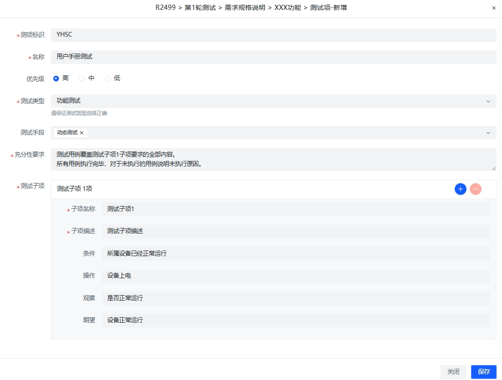

新增测试项后，会在CRUD表格显示新增的测试项，并在树状目录加载新测试项信息

点击「+」可以新增测试子项，为了避免占用屏幕过大，用户可以折叠

点击「-」可以删除测试子项，但必须保留一项子项

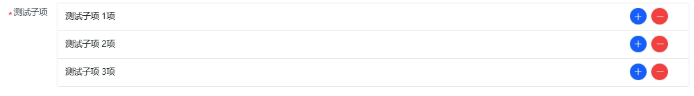

### 修改

点击「修改测试项」按钮即可修改已存在的测试项，字段和新增一模一样

### 删除

可**勾选删除**或**单个删除**，多选删除可能会遇到缓存未清空的情况，需要切换到其他非测试项节点目录然后切换回来

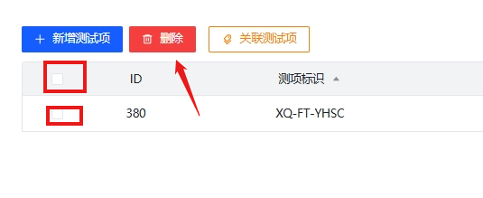

如果需要一次性删除更多测试项，可将分页设置为100条/页，然后全选后删除

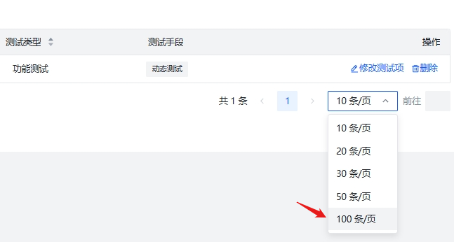

注意上层节点被删除后，所属界面一并清空，请**谨慎**删除

### 特殊功能-关联测试项

点击「关联测试项」按钮，弹出“关联测试项”弹窗，该按钮可以让设计需求关联非子节点的测试项

例如：您在测试过程中遇到《研制总要求》《需求规格说明》的设计需求均对应一个测试项，则你可以将测试项录入到《需求规格说明》设计需求下方，然后在《研制总要求》的设计需求点击「关联测试项」关联非子节点的测试项，**这样可以在生成文档表格中显示追踪关系新增一条，并在追踪表格中显示关系**

- 已存在关联项，即该设计需求已关联的非子测试项信息
- 选择关联的测试需求项：
  - 记住：无法关联子测试项，只能关联非子测试项，如果关联自己则会弹出提示“选择的测试项全部存在于当前设计需求中，请重新选择..”

    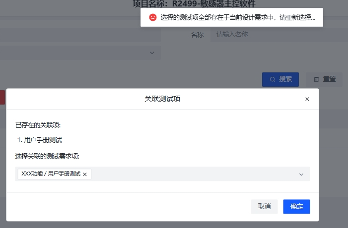
  - 关联确定后，会在已存在的关联项显示关联的“非子测试项”信息
  - 取消关联：直接在多选框删除然后点击「确认」按钮

    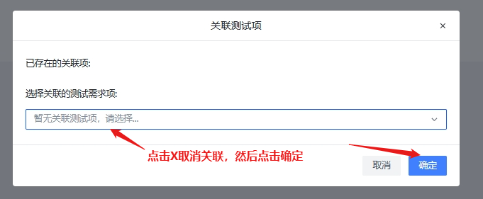

### 树状目录右键-根据测试子项生成用例

本系统支持测试项直接生成测试用例，其基本逻辑是：

1. 将测试子项描述 → 直接变为用例综述
2. 将测试子项名称 → 直接变为用例名称
3. 测试步骤-操作 → 将测试子项中四个字段拼接为一段话

注意：

1. 自动生成的用例执行时间、是否通过、执行状态均为未执行，需要在执行用例时候修改
2. 自动生成的用例执行结果是未填写状态，请记得在生成文档之前填写

### 树状目录右键-复制到设计需求下

本系统提供测试项（包含子节点）整体复制到其他设计需求下面，右键点击“测试项”节点，并点击「复制到设计需求下」，弹窗显示如下

1. 提供复制到任意设计需求的功能
2. 可以选择**深度复制**以及仅复制该测试项

选择好以上两点，点击「确认」即可复制到对应设计需求节点下面，注意复制后测试标识、名称系统会帮你加上“（复制）”的字样避免标识重复，请在复制后立即进行修改

### 树状目录测试项的拖拽

目前拖拽仅支持测试用例节点的拖拽，测试项可作为测试用例被拖拽对象，但不能直接拖拽测试项节点，当用户拖拽测试项节点放下时，会提示“只能拖拽用例节点”

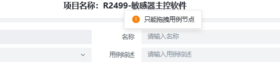

### 6）测试用例

点击树状目录测试项节点即可在右侧打开所属测试用例信息

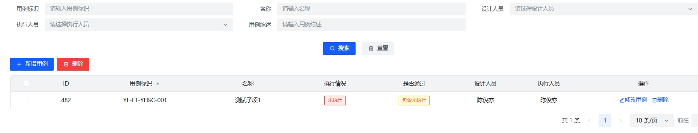

### 新增

点击「新增用例」，打开新增用例弹窗，相关字段：

- 用例标识：对应系统储存用例的key值，用户无需关系
- 名称：必填，测试用例的名称
- 人员信息：对应测试记录中的设计人员、执行人员、审核人员，数据均来自于用户信息
- 用例综述：对应测试说明中的用例综述
- 用例初始化：固定填写“软件正常启动，正常登录进软件”，也可用户自己修改
- 前提和约束：固定填写“软件正常启动，各界面显示工作正常”，也可用户自己修改
- 执行时间：对应测试记录中执行时间
- 测试步骤：
  - 可新增、删减以及折叠
  - 操作：具体用例的操作，富文本
  - 预期：填写预期结果
  - 结果：执行的结果信息，关联测试记录的结果结论，富文本
  - 是否通过：用例的是否通过，关键信息
  - 执行状态：用例是否执行，关键信息

### CRUD显示执行情况和通过情况

在测试项节点点击，右侧显示的用例，会在表格显示“执行情况”和“是否通过”，具体逻辑如下：

- 用例步骤全部执行 → 已执行
- 用例步骤部分执行 → 部分执行
- 用例步骤全部未执行 → 未执行

通过情况显示逻辑如下：

- 用例步骤有一个步骤未通过 → 显示未通过
- 用例步骤全部通过 → 显示通过
- 用例步骤包含一个未执行 → 显示包含未执行

### 树状目录符号逻辑-显示用例和问题单关系

- 如果测试用例未通过，如果没有关联问题单 → 显示“X”并且在树状目录标红，提示用户请关联问题单
- 如果测试用例已执行且没有不通过的步骤 → 则显示“>”
- 如果测试用例未通过，已有问题单关联，但该问题单未关闭 → 则显示“@”，则提示用户进行关闭

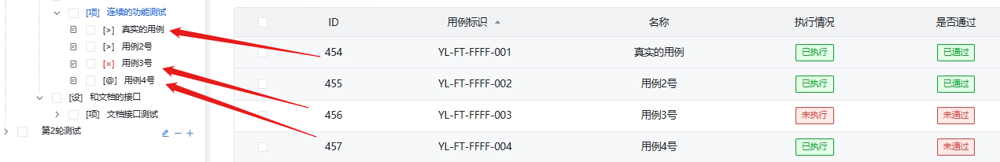

### 拖拽功能

树状目录的用例节点允许进行拖拽，主要功能分为复制/移动功能

#### 用例拖拽到测试项节点

将用例拖拽到测试项节点，弹出弹窗，选择复制或移动，如果选择复制则将用例复制一份到目标测试项，如果是移动则将本身所属测试项删除，移动到目标测试项下面

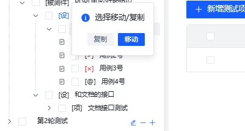

注意移动和复制，系统均帮你修改用例标识，例如“YL\_FT\_XXXX”将XXXX修改为所属测试项的标识，但是名称等信息需要用户在移动或复制后进行修改

### 用例拖拽到其他用例节点的前后

用例节点，可以由用户拖拽到其他用例节点的前后，并弹出复制/移动弹窗

选择复制，则复制一份用例到对应目标测试用例前后

选择移动，则进行移动

注意：本测试项节点下进行拖拽，只是改变测试用例的排序，不会响应其他内容

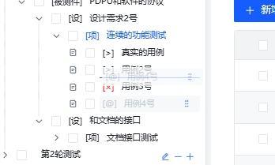

## 6）问题单

问题单和测试用例虽然多对多关系，但是一个用例只允许一个问题单，在已存在问题单的测试用例下点击「新增问题单」则会报“该用例已经存在问题单了，可在轮次节点右键添加非关联问题单”

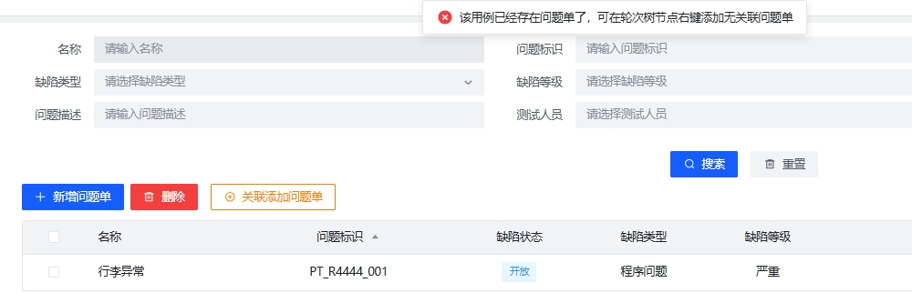

有时候需要添加非关联问题单，则可以右键“轮次”节点，打开轮次所属的问题单

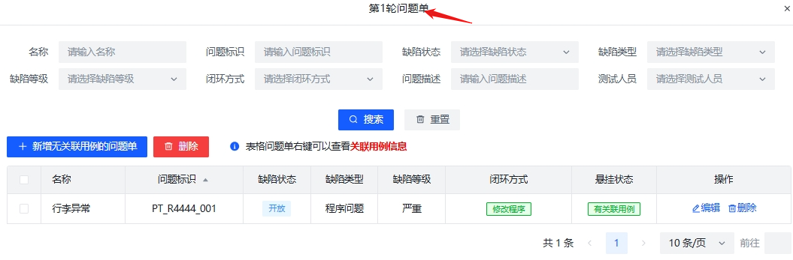

### 新增

点击「新增问题单」可弹窗添加测试用例所属问题单，相关字段：

- 名称：必填，问题单名称
- 问题标识：系统的标识，用户无需关心
- 缺陷状态：必填，在生成最终文档时候记得关闭所有问题单，否则《测评报告》会出现未闭环的问题单
- 闭环方式：问题单表格中闭环方式
- 缺陷等级：问题单表格中缺陷等级
- 缺陷类型：问题单表格中缺陷类型
- 问题描述：富文本，描述该问题出现情况
- 问题影响：问题单表格中的问题影响
- 原因分析：开发方反馈，填写具体原因，富文本
- 影响域分析：问题单表格的影响域分析
- 改正措施：问题单表格直接渲染的改正措施
- 回归结果：在回归测试进行填写，例如：第二轮您需要回到第一轮进行填写问题单回归测试情况
- 测试人员：问题单测试人员，关联系统用户
- 开发人员：必填，问题单开发人员填写准确的开发人员信息
- 回归人员：问题单回归人员，关联系统用例

新增问题单后，树状目录用例前面符号以及右侧问题单表格均进行刷新显示

### 取消关联

问题单是关联用例的，但是问题单可关联多个用例

问题单在系统是有2种状态，一种是“悬挂”，一种是“关联”

点击树状目录用例节点，右侧则显示该用例关联的问题单表格，在右侧表格点击「关联添加问题单」即可打开问题单信息表格，该表格显示所有问题单

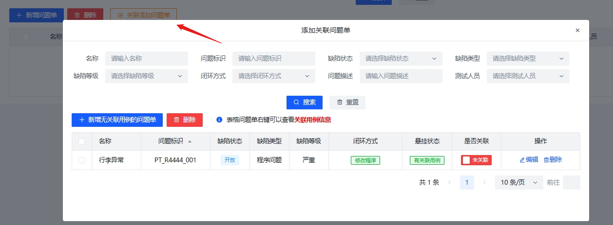

该表格功能：

1. 可以直接新增“无关联用例的问题单”
2. 显示“悬挂”状态，如果为绿色则有关联的用例，为红色为该问题单没有关联用例
3. 点击「关联按钮」，即可将该问题单关联到用例上
4. 可以当做普通CRUD进行查询/删除/编辑问题单等操作

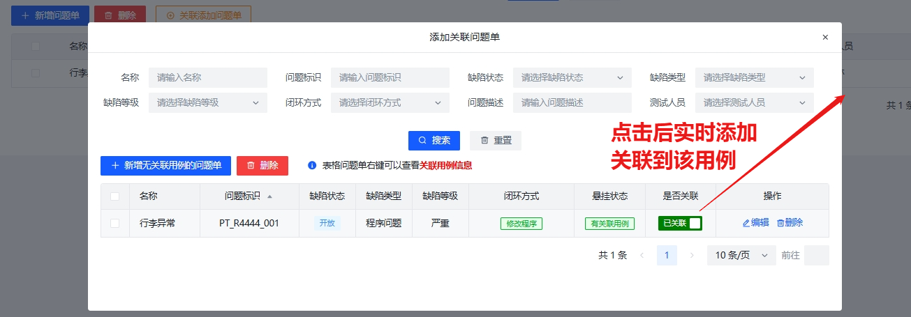

## 工作区返回项目管理页面

点击工作区左上角测试平台标题，则回到主页面

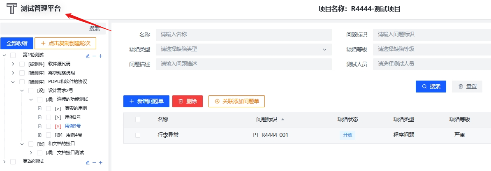

## 附录

### 附录1强制弹窗源代码被测件创建的信息

- 设计需求创建3个
  - 静态分析：

    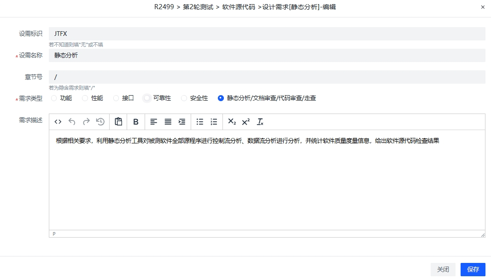
  - 代码审查

    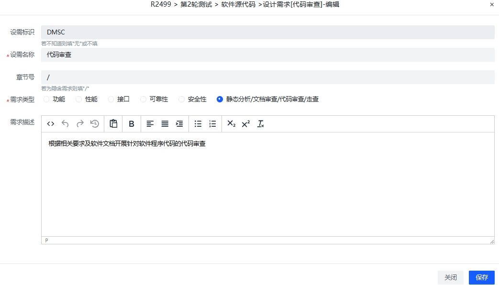
  - 文档审查

    
- 测试项创建3个
  - 静态分析

    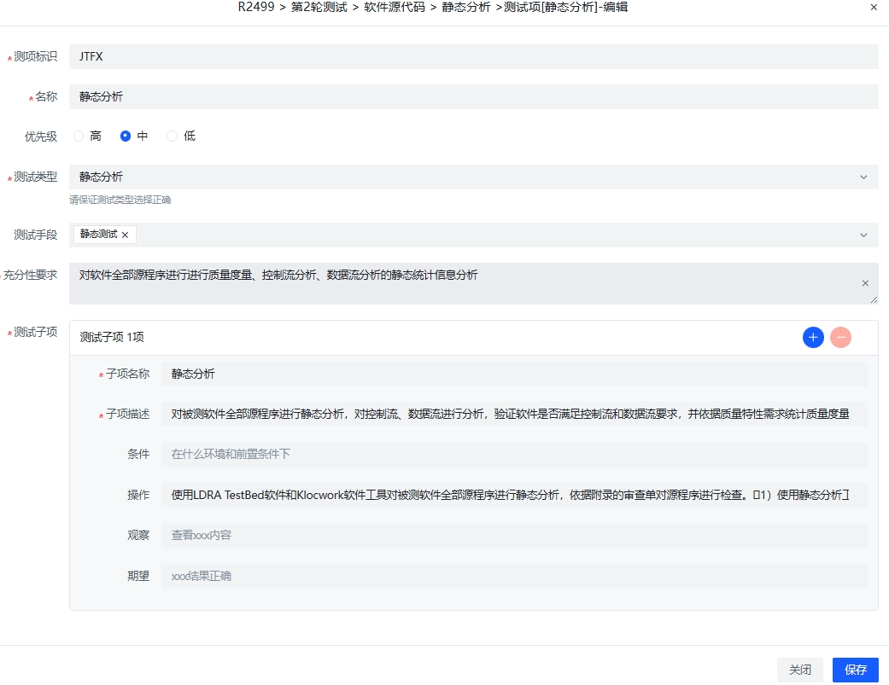
  - 代码审查

    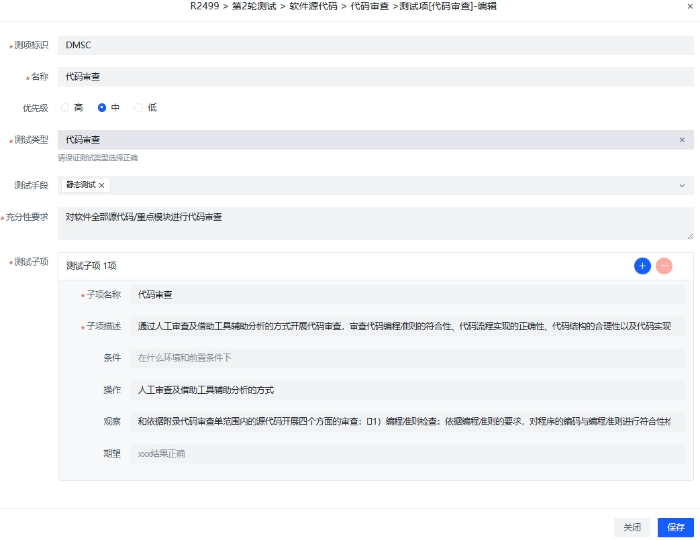
  - 文档审查

    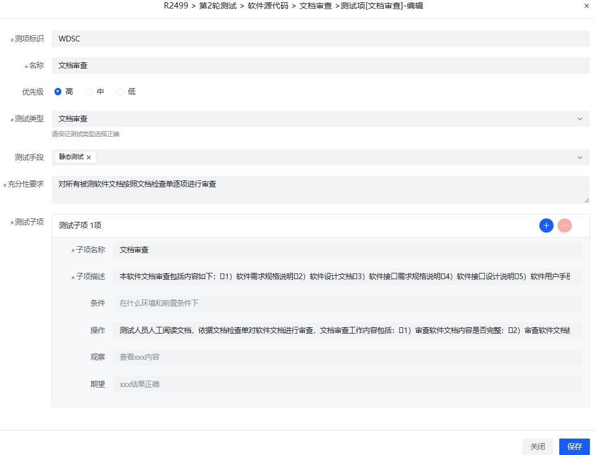
- 用例创建3个
  - 静态分析

    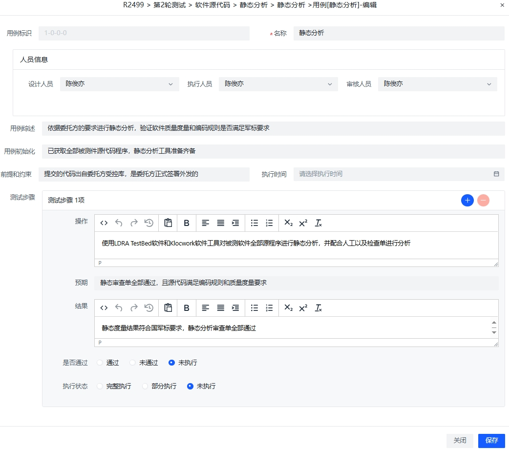
  - 代码审查

    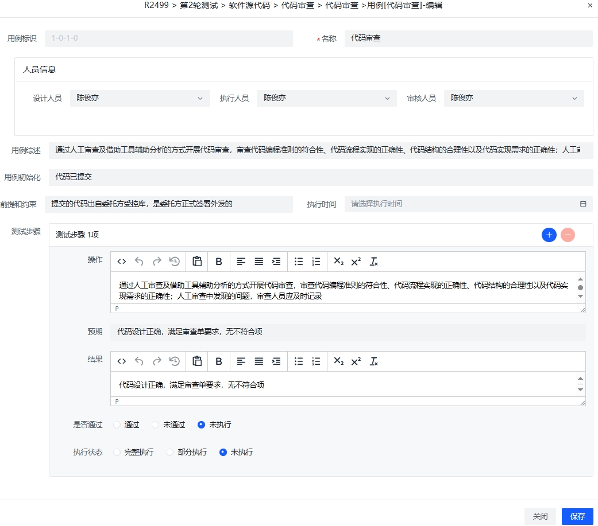
  - 文档审查

    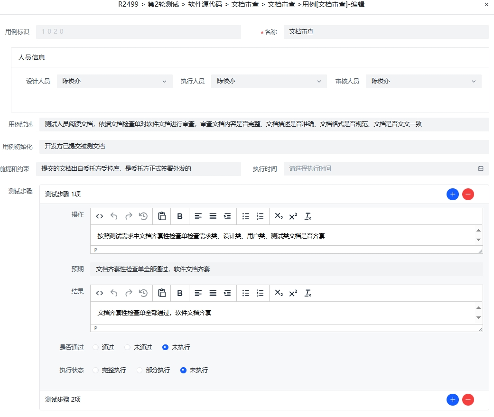

### 附录2上传需求文档解析为设计需求预录入数据规则

在需求文档中，如果要上传解析，目前必须遵守如下几个规则：

1. 目前程序解析上传文档，只解析**接口**和**功能需求**
2. 功能需求章节名称必须包含“CSCI功能需求”或“CSCI能力需求”，接口章节的名称必须包含“CSCI外部接口需求”
3. 功能需求章节和接口章节必须为2级标题
4. 需求文档设计需求按段落（paragraph）来解析，并在设计需求预录入数据中以“XXXX-XXX-p1”（为一个段落），“XXXX-XXX-t2”（为一个表格）

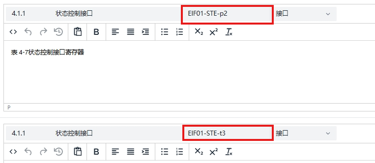

因为解析不成熟，所以必然会让用户人工进行审查和修改、删减，**后续版本进行改进**
