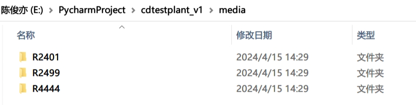
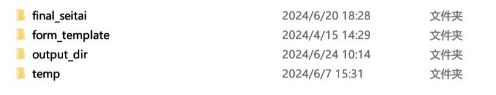
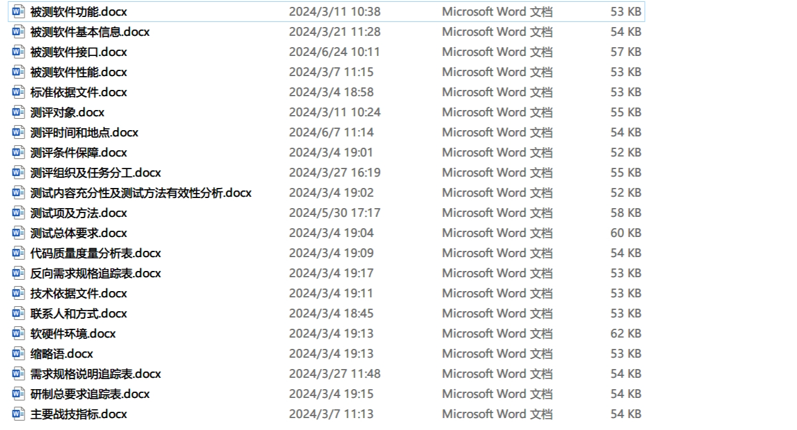
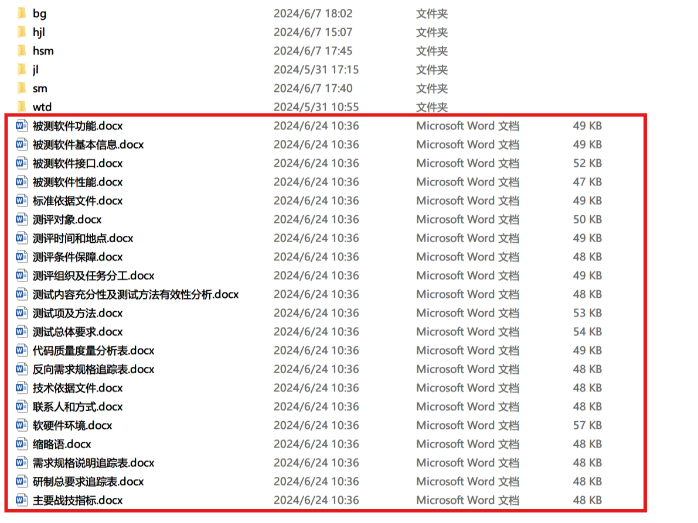
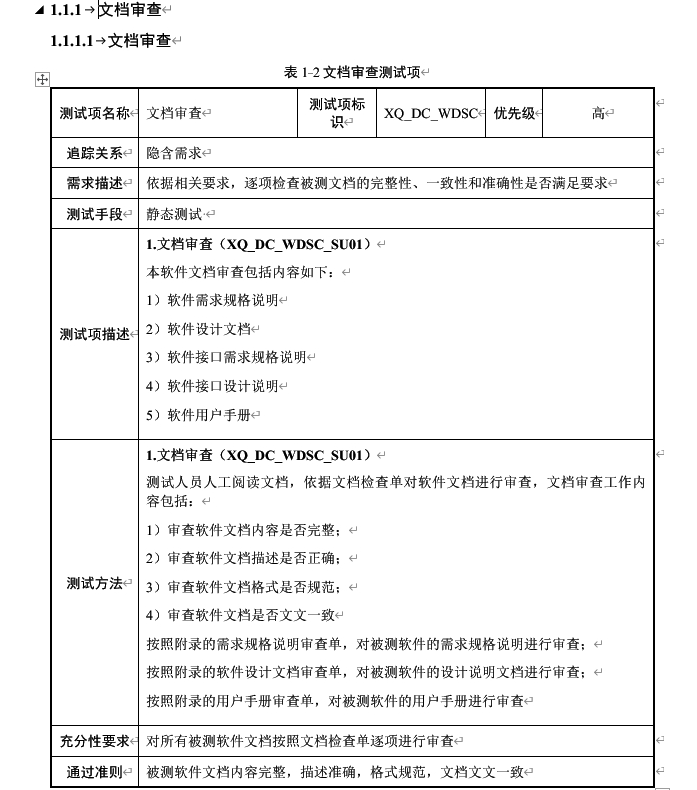
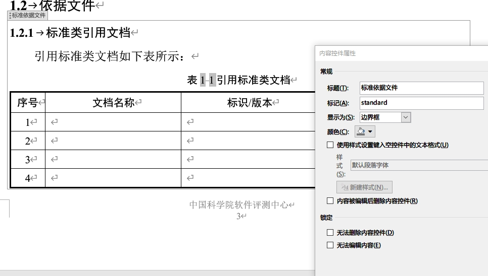
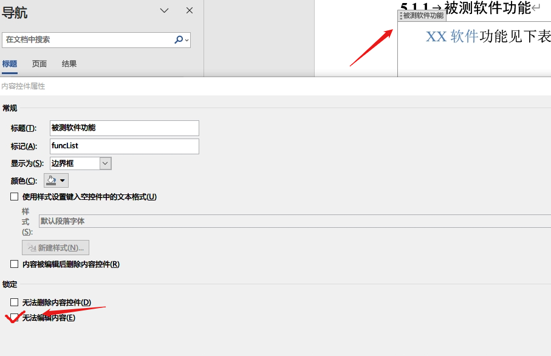
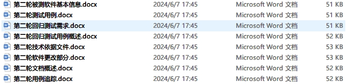

# 3.生成文档

## 目录

- [1）文档目录结构](#1文档目录结构)
- [2）生成产品文档逻辑](#2生成产品文档逻辑)
  - [以生成最终大纲为例](#以生成最终大纲为例)
    - [1.生成大纲二段文档](#1生成大纲二段文档)
    - [2.最终文档生成逻辑](#2最终文档生成逻辑)
    - [3.设置控件为无法编辑内容](#3设置控件为无法编辑内容)
    - [4.用户可修改内容与程序不冲突内容](#4用户可修改内容与程序不冲突内容)
- [3）详细生成规则](#3详细生成规则)
  - [1.测评大纲](#1测评大纲)
  - [2.测试说明](#2测试说明)
  - [3.测试记录](#3测试记录)
  - [4.回归测试说明](#4回归测试说明)
  - [5.回归测试记录](#5回归测试记录)
  - [6.问题单](#6问题单)
  - [7.测评报告](#7测评报告)

本系统生成文档为人工编辑加系统结构化数据结合的方式进行生成

其文档片段库和模版库均在服务器根目录下面的/media下面

## 1）文档目录结构

如上图所示，在/media目录下面，存放着项目标识目录，一个项目对应一个目录

每一个项目目录下，固定分为4个目录

目录解释：

- final\_seitai - 存放着产品文档（最终文档），该文档需要用户点击【项目管理】-【+文档生成】下面生成最终文档的按钮即可生成
- form\_template - 存放**片段库的模版**文件以及**最终文档的模版**
- output\_dir - 存放根据模版生成的片段文件，该文档需要用户点击【项目管理】-【+文档生成】下面的二段文档生成按钮即可生成
- temp - 用户无需操作的文档

## 2）生成产品文档逻辑

### 以生成最终大纲为例

#### 1.生成大纲二段文档

大纲最终文档模版在`/form_template/products/测评大纲.docx`

大纲片段模版文档在`/form_template/dg`下面，目前一共21个模版文档

用户在录入第一轮次的全部测试项后即可生成测评大纲，在平台项目管理，点击「+文档生成」，然后点击「大纲二段文档」，平台会根据录入的结构化数据填充到`/form_template/dg`下21个文档，最终将21个文档生成文档片段储存在`/output_dir`下面

其片段模版`/form_template/dg`如下所示：

生成的文档片段`/output_dir`如下所示：

打开`/output`下面的文档片段，可以看见数据已填充，例如`测试项及方法.docx`

#### 2.最终文档生成逻辑

首先在`/form_template/products/测评大纲.docx`模版中，有两种**动态数据**：

1. 一个是平台程序去解析的例如{{ }}这样的数据，是根据结构化数据直接填充
2. 另一种是word控件，打开控件属性，即可看到标题和标记，在word控件中的数据均会被`/output_dir`下面的文件片段进行替换，逻辑是程序会根据标题名称去查找`/output_dir`下面的docx文件，找到即替换`/form_template/products/测评大纲.docx`里面的控件内容

   

用户在项目管理页面，点击「+文档生成」，然后点击「生成最后大纲」按钮，平台即替换以上两种数据并生成最终文档`/final_seitai/测评大纲.docx`

#### 3.设置控件为无法编辑内容

用户可打开`/form_template/products/测评大纲.docx`文件，假如大纲中5.1.1章节“被测软件功能”，用户需要自己完全在docx文档中写，可在控件中编写自己的内容并在word中【开发工具】-【属性】打开控件详情，勾选【无法编辑内容】，程序会识别用户是否勾选，如果勾选，则生成最后大纲则不使用文档片段进行替换

#### 4.用户可修改内容与程序不冲突内容

- `/form_template`下面的文件(除去`/form_template/products`)，程序不会对非{{  }}（胡子语法）内容进行任何更改，用户可自定义非“胡子语法”的内容
- `/output`下面的文件为二段文件，为文档片段，用户修改后会直接插入到`/form_template/products`中文档的**控件**中，即用户可直接在二段文档进行修改【注意：你每次点击「+二段文档」均会重新根据片段模版生成output下面文件】
- `/form_template/products`下面的最终文档模版文件，用户除了可以自己勾选“无法编辑内容以外”，还可以对非控件内容进行随意修改，和程序处理不冲突

## 3）详细生成规则

### 1.测评大纲

测评大纲最终模版总计21个文档片段，将/form\_template/dg下21个文档生成为/output\_dir下面的21个文档

- 被测软件功能：生成大纲被测软件功能章节的功能列表，表中功能名称为设计需求名称，用途与说明为用户录入的设计需求描述（注意图片、表格也会复制过去，请酌情删减）
- 被测软件基本信息：生成大纲被测软件基本信息表格
- 被测软件接口：生成大纲中被测软件接口，根据类型为“接口”的设计需求填写表格，**外部接口图片**请在`/form_template/dg/被测软件接口.docx`中修改或在`/output_dir/被测软件接口.docx`修改
- 被测软件性能：生成大纲中被测软件性能，根据类型为“性能”的设计需求生成，注意性能设计需求**不要填入表格或图片**
- 标准依据文件：根据录入的项目标准自动生成
- 测评对象：该片段需要用户**自己全部编写**
- 测评时间和地点：生成时间逻辑见文档《2.工作区》的附录
- 测评条件保障
- 测评组织及任务分工
- 测试内容充分性及测试方法有效性分析
- 测试项及方法：根据录入测试项生成表格
- 测试总体要求：测试类型表格需要**用户填写**，为选取测试类型也需**用户填写**
- 代码质量度量分析表：需要**用户自己填写**
- 反向需求规格追踪表
- 技术依据文件：根据平台中被测件信息自动填写
- 联系人和方式：根据项目联系人信息自动填写
- 软硬件环境：该章节需要**用户全部自己填写**
- 缩略语
- 需求规格说明追踪表
- 研制总要求追踪表 - 项目报告类型必须为“鉴定测评”
- 主要战技指标 - 项目报告类型必须为“鉴定测评”

### 2.测试说明

测试说明部分片段使用的是大纲的片段库，所以只包含属于自己的4个片段模版，片段模版路径为`/form_template/sm`下面4个文件，二段片段生成在`/output_dir/sm`下面

- 测试用例：根据平台用例数据和步骤生成
- 技术依据文件：在大纲技术依据文件基础上添加上《测评大纲》
- 说明追踪
- 用例说明

### 3.测试记录

二段片段模版在`/form_template/jl`，二段片段生成在`/output_dir/jl`

- 测试用例记录：注意无论平台是否录入用例执行的结果都会生成，那么如果没有录入则显示为空

### 4.回归测试说明

二段片段模版在`/form_template/hsm`，二段片段生成在`/output_dir/hsm`

注意回归测试的文档可能会生成多个，每一个轮次会生成一份文档

- 被测软件基本信息：生成非第一轮次源代码被测件信息
- 测试用例
- 回归测试需求：即非第一轮测试项的**测试项**
- 回归测试用例概述
- 技术依据文件：在大纲的技术依据文件上添加《测评大纲》《测试说明》《测试记录》《第x轮测试说明/记录》
- 软件更改部分：里面表格需要**用户填写**
- 文档概述
- 用例追踪

### 5.回归测试记录

二段片段模版在`/form_template/hjl`，二段片段生成在`/output_dir/hjl`

- 被测软件基本信息：按轮次属性生成多个
- 测试用例记录

### 6.问题单

二段片段模版在`/form_template/wtd`，二段片段生成在`/output_dir/wtd`

- 问题详情表：根据录入的问题单自动生成文档

### 7.测评报告

用户需要在平台项目全部用例执行完毕，问题单编写关联完毕后点击生成

二段片段模版在`/form_template/bg`，二段片段生成在`/output_dir/bg`

- 被测软件基本信息：每个轮次源代码被测件的信息
- 测评时间和地点：逻辑请查阅《2.工作区》文档
- 测评完成情况
- 测试内容和结果\_第x轮次：自动统计
- 测试有效性和充分性说明：自动统计
- 技术依据文件：添加产品文档的依据
- 软件质量评价：**用户需要填入**“模块平均圈复杂度”“平均扇出数”
- 问题汇总表：根据每个轮次问题单信息自动填写
- 需求指标符合性情况：分为需求符合性情况表以及指标符合性情况表，这里简单将“设计需求”的信息以表信息列出，并列出关联的测试项和通过情况（如果有一个用例未通过则显示“未通过”）
- 研总需归追踪
- 综述
- 总体结论：固定内容，并列出所有轮次源代码版本信息
