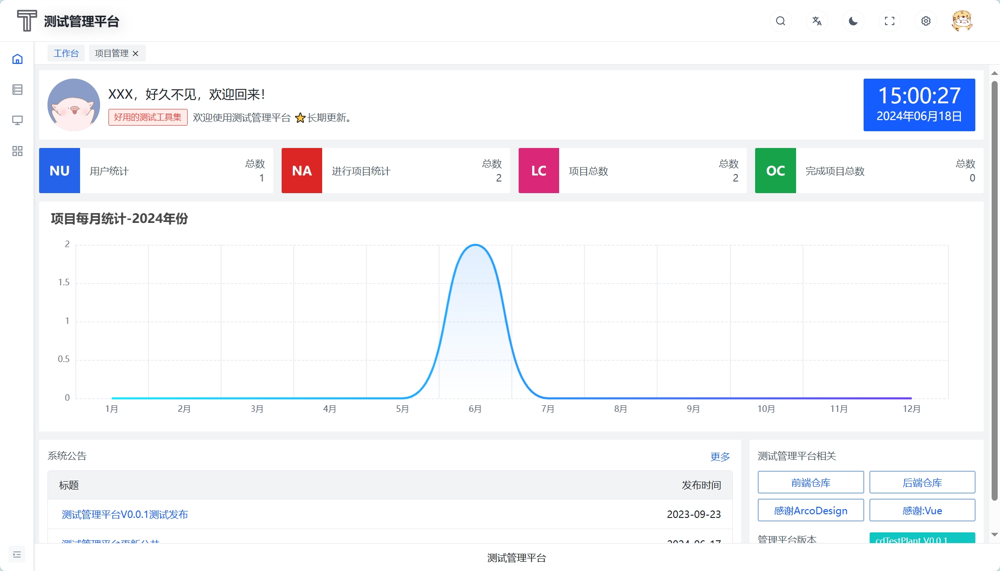
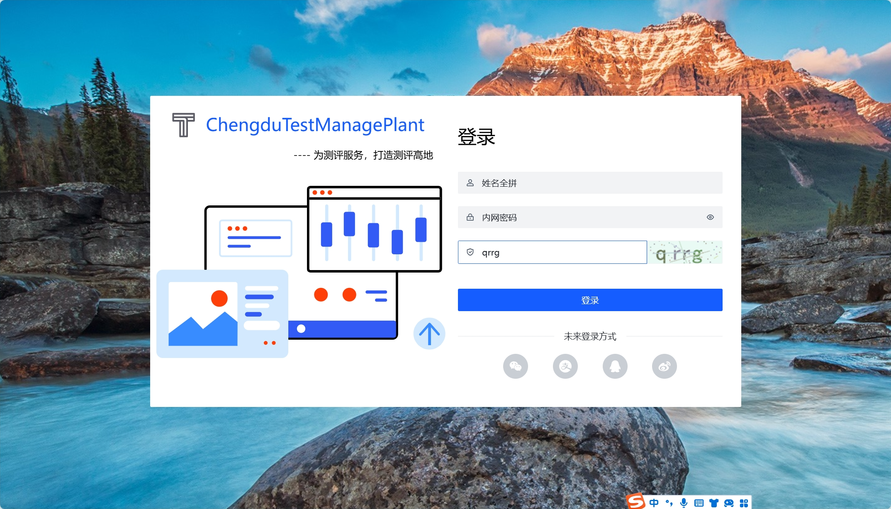
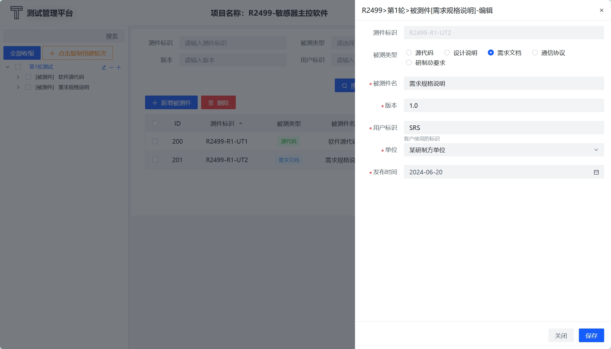
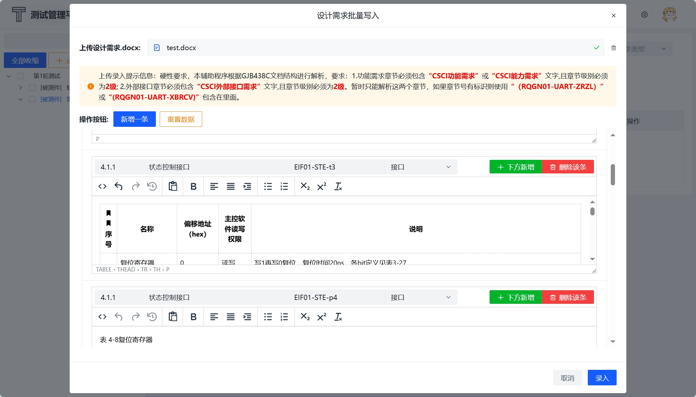
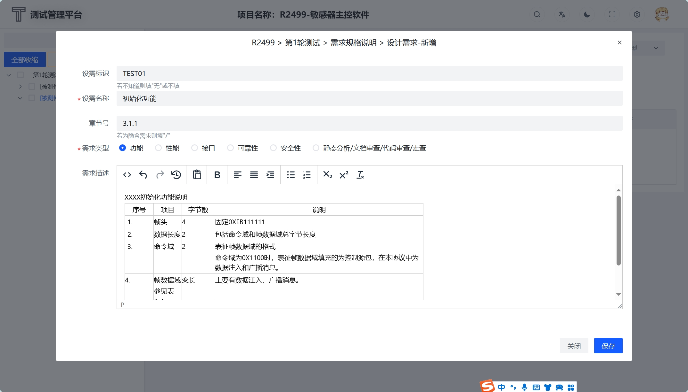
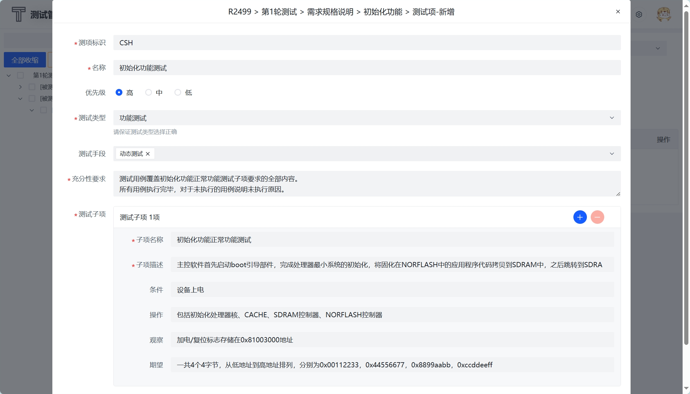
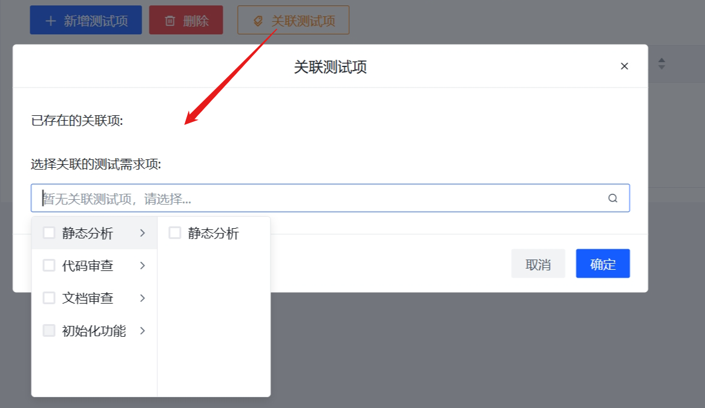
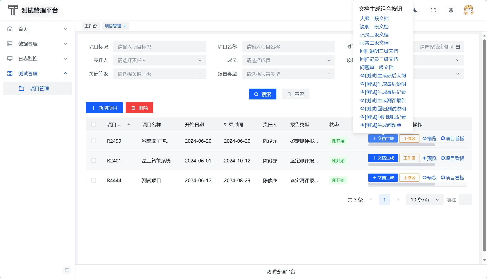
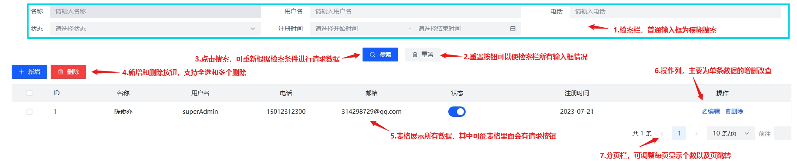
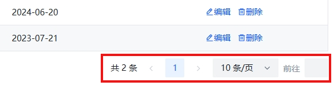

# 测试管理平台V0.0.1操作手册

## 目录

- [概述](#概述)
- [什么是TestPlant](#什么是TestPlant)
  - [概述](#概述)
  - [模块列表](#模块列表)
  - [使用场景](#使用场景)
    - [1.外出/内网工作](#1外出内网工作)
    - [2.测试管理](#2测试管理)
    - [3.人工编辑文档和程序融合](#3人工编辑文档和程序融合)
- [快速使用](#快速使用)
  - [1.使用内网LDAP账号登录](#1使用内网LDAP账号登录)
  - [2.创建项目](#2创建项目)
  - [3.进入工作区](#3进入工作区)
  - [4.生成文档](#4生成文档)
- [关于兼容性](#关于兼容性)
- [说在前面](#说在前面)
- [CRUD页面统一说明](#CRUD页面统一说明)

## 概述

`TestPlant`是测评中心打造的人机协同文档生成工具，帮助测试人员录入测试过程数据以及快速生成产品文档。在使用cdTestPlant过程中遇到的问题，均可以查看该手册快速查找帮助。

## 什么是TestPlant

### 概述

测试文档是测评中心在测试活动后最终交付的产品，其中内容包括结构化数据（例如项目信息、轮次信息、被测件信息、测试项信息、测试用例信息、测试步骤信息、问题单信息），也包括非结构化数据。测试文档中所有信息都由程序来管控是极其复杂的，`TestPlant`就将两种信息分别管理，测试人员和平台都可以对最终文档信息进行编辑和改变，最终由测试平台来生成产品文档。

`TestPlant`界面类似于后台管理系统，除文档生成外，还会更新诸多航天、BD测评中的工具功能，还会结合一些项目管理功能。

### 模块列表

`TestPlant`平台模块介绍如下：

<!-- wolai-table:{"header":false,"columnWidths":[129,595]} -->

| 模块         | 说明                                                                                                                                                                                                                          |
| ---------- | --------------------------------------------------------------------------------------------------------------------------------------------------------------------------------------------------------------------------- |
| 工作台        | 主要展示当前动态时间、用户名称、总体用户统计、项目总数和统计图表、后台发布公告等                                                                                                                                                                                    |
| 用户中心       | 主要展示近5条操作日志、登录日志、账户名称、账户账号以及个人资料信息，不提供编辑功能，该功能由内网LDAP控制                                                                                                                                                                     |
| 用户管理       | 主要展示当前系统用户信息，该信息从LDAP服务器拉取 1、权限为管理员的用户可新增非LDAP用户并且可以编辑非LDAP用户信息，包括激活状态 2、普通用户无法编辑、删除、新增非LDAP用户 3、LDAP用户认证由LDAP服务器提供，故无法由本系统控制 4、在每次任意用户登录时候，平台会自动进行LDAP认证并拉取全部LDAP用户信息，如果没有连接服务器则会弹出提示 5、包含基本的查询功能 |
| 字典管理       | 用于动态生成结构化备选数据，例如运行环境、开发环境、测试方法、项目安全等级、软件平台类型、编程语言、测试标准、需求类型、测试项优先级、通过类型、问题状态等，可新增/编辑字典数据给项目数据提供数据选项                                                                                                                         |
| 项目联系信息/缩略语 | 主要关联项目信息，在编辑项目时可动态选择项目联系人信息、缩略语信息，以致在生成文档时插入这些信息                                                                                                                                                                            |
| 日志模块       | 包含结构化数据日志、接口操作日志、登录日志，均可由管理员用户进行删除，数据操作日志可检索用户名和时间，接口操作日志、登录日志只能检索用户                                                                                                                                                        |
| 项目管理       | 时间倒序展示项目，包含项目看板、项目预览信息、新增、编辑、删除、检索（CRUD）功能；项目信息和word片段库和模版库紧密相关，一个项目就维护着一套所属片段库和模版库；提供二级文档生成按钮、最终文档生成按钮等                                                                                                                    |
| 文档生成       | 包括生成大纲二段文档、说明二段文档、记录二段文档、报告二段文档、回归说明二段文档、回归记录二段文档、问题单二段文档，最终大纲、最终说明、最终记录、最终报告、最终问题单、最终回归说明、最终回归报告                                                                                                                           |
| 工作区        | 主要录入测试过程结构化数据的区域，包含一个树状目录、以及右侧编辑区域各层级（项目→轮次→被测件→设计需求→测试项→用例→问题单）的数据录入，给生成文档提供数据支持                                                                                                                                           |

### 使用场景

#### 1.外出/内网工作

cdTestPlant提供外出无网环境下的文件夹，运行文件夹里面的脚本即可安装平台相关组件模块，安装后启动后端后即可访问浏览器进行工作。

在工作地点，也提供主要后端程序运行，在内网直接访问地址即可进行工作。

#### 2.测试管理

专业的测试管理工具，工作区以一个项目（配置项）为单位，以树状目录逻辑（项目→轮次→被测件→设计需求→测试项→用例→问题单）来管理整个测评项目。

#### 3.人工编辑文档和程序融合

每一个项目都对应服务器上或本机上一个文档目录，文档目录中包括最终模版文档、二级片段库模版文档、二级片段文档、最终生成文档，测试人员灵活编辑模版以及片段文档来达到和机器相互协同工作的目的。

## 快速使用

### 1.使用内网LDAP账号登录

为了帮助您快速体验测试平台，请使用内网LDAP账户访问 → \*\*`内网服务器:8181`\*\*端口即可访问

若您在内网登录，在首次进入主页时候，会默认从内网LDAP服务器拉取所有用户信息，LDAP账户均不是系统管理员权限

### 2.创建项目

在登录系统后，可点击左侧导航栏进入项目管理页面，在项目管理页面，展示已有项目列表，点击「新增项目」，打开弹窗填写必填信息（红色星号“ \*”）的字段，点击保存即可创建，项目创建时默认会在服务器根目录/media创建和项目标识同名目录，里面存放着二级文档模版、最终文档模版。

- 项目标识：项目的唯一标识，和测评中心体系的项目标识填写一致
- 项目名称：用于生成最终文档名称有关
- 工程型号、分系统、子系统、设备名称：暂无使用
- 开始日期，结束日期：同轮次的开始时间和结束时间一同决定产品文档中的时间，其基本逻辑为：
  - 项目开始日期 → 被测件接受日期
  - 大纲编制开始时间 → 项目开始时间+1天
  - 大纲编制结束时间 → 大纲编制开始时间+6天
  - 测评设计与实现开始 → 大纲编制结束+1天
  - 测评设计与实现结束 → 测评设计与实现开始+5天
  - 其中每个产品文档（大纲、说明、记录、回归说明、回归记录、报告、问题单）的签署时间逻辑均为以【封面时间为基础】 → 拟制时间：封面时间-2天，校对时间：封面时间-1天，审核/批准时间：封面时间，V1.0版本时间：封面时间
  - 关于封面时间 → 大纲：大纲编制结束时间，说明：大纲时间中测评设计与实现结束时间，记录：为用户填写第一轮测试结束时间，问题单：最后一轮用户填写结束时间，回归说明：每个轮次的开始时间，回归记录：每个轮次的结束时间，报告：项目结束时间
  - 关于报告中测试过程时间 → 均是以上面时间为基础推断，其中推断3个时间，分别是需求分析结束时间为大纲编制时间+2天，策划开始时间为需求分析时间+1天，策划结束时间为报告编制结束时间
- 其他按照界面内容填写后保存，即可创建项目

### 3.进入工作区

首次创建项目后，会自动添加第一轮测试轮次信息，点击「工作区」进入项目工作主页

由于生成文档要求必须有每个轮次的源代码被测件（dut），所以进入工作区后，自动检测是否有源代码被测件，如果没有则强制要求创建，在输入代码版本、客户标识、单位、发布时间、代码统计信息后，创建基本第一轮的源代码被测件 → 另外还自动创建静态分析、代码审查、文档审查三个设计需求、测试项以及用例

树状目录中，**单击**表示查看当前节点**下级节点**的管理界面，**双击**表示远程获取子节点的数据

- 创建需求规格说明**被测件（dut）**

  点击第一轮测试，右侧会弹出管理被测件（dut）的管理界面，点击新增被测件 → 添加需求规格说明文档

  

  添加完毕后可以看到树状目录和被测件列表立即显示新建被测件“需求规格说明”
- 单击新建的“需求规格说明”，可以**新增/编辑/删除设计需求**，并且可以设计需求批量导入填写（并且有预览界面可以编辑录入前的设计需求信息）

  

  新增/编辑设计需求页面，富文本框可以赋值word中的表格数据（支持数据包括：表格、普通文本、嵌入图片三种，其他暂不支持）

  
- 新增测试项

  设计需求下面节点为测试项，单击设计需求树状目录节点，可以打开该节点下测试项管理界面，点击「新增测试项」按钮，即可创建测试项，测试项决定测评大纲中测试项章节的全部内容

  

  另外，由于设计需求可能和当前测试需求都对应该测试项，可以点击「关联测试项」即可将不同的设计需求关联到同一个测试项，这样在生成大纲以及后续文档中，**追踪关系**即可添加

  
- **新增/编辑用例**

  点击测试项，查看子节点（用例）管理界面，您有**两种方式创建用例**：
  1. 可点击「新增用例」按钮进行新增，逐项填写并保存
  2. 右击树状节点测试项 → 根据测试项的测试子项创建用例，一个测试子项自动生成一个测试用例
- **问题单**

  点击测试用例，可打开该用例关联问题单的管理页面，可以新增问题单，问题单和用例是多对多关系，你可以多种方式创建问题单：
  1. 右击轮次信息，创建不关联用例的问题单
  2. 点击用例节点，点击「新增问题单」，填写信息
  3. 点击用例节点，点击「关联添加问题单」，可随时取消和用例关联或关联用例

### 4.生成文档

生成文档程序逻辑较为复杂，主要是分为两部分，分别为生成二级文档和最终文档

在服务器项目media目录存放着所有文档模版和片段，在填写完毕信息后，需要先点击产品文档的二级文档，当生成结束后，即可根据片段模版生成片段库，用户可以修改片段库的信息，然后在点击生成最后文档即可生成。

至此，该平台完成一个基本项目已完毕。

## 关于兼容性

平台前端页面不支持IE浏览器访问，请使用谷歌浏览器、Edge浏览器进行访问。

## 说在前面

目前浏览器为小团队开发，目前还在紧急测试中，如果发现问题请发送邮件到314298729\@qq.com，我们会尽力修改所有的bug。

## CRUD页面统一说明

本平台，在工作区页面、项目管理页面、用户管理页面均使用同一表格增删改查组件，其基本功能如下所示，特有功能在后续操作手册中说明

关于分页，统一显示数据总条数、当前页、上一页、下一页、每页显示条数、前往页数

[0.平台放内网策略](0.平台放内网策略/0.平台放内网策略.md "0.平台放内网策略")

[1.基础使用](1.基础使用/1.基础使用.md "1.基础使用")

[2.工作区](2.工作区/2.工作区.md "2.工作区")

[3.生成文档](3.生成文档/3.生成文档.md "3.生成文档")

[2024-10-24的GIFS](2024-10-24的GIFS/2024-10-24的GIFS.md "2024-10-24的GIFS")

[测试平台更新日志](测试平台更新日志/测试平台更新日志.md "测试平台更新日志")
